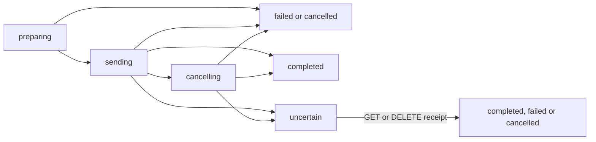

# Transfer lifecycle and recovery

A transfer is accepted after validating its saved-project association, source and paired device. Acceptance schedules work; it is not evidence of remote publication. Completion requires a matching receiver receipt containing the operation ID, filename, size and SHA-256.

## Sender intent and streaming

| Phase | Contract |
| --- | --- |
| Admission | Saved `projectId` must exist and its path match chat `cwd`; device paired; no pairing in progress; at most four tasks |
| Deduplication | SHA-256 signature of chat, source turn or request key, device, path and output name; existing signature returns original transfer with `accepted:true` |
| Conflict guard | Active or uncertain operation to the same device/name blocks a different send, including records outside the 100-row display history |
| Prepare | Open pinned source, hash, compare size/mtime before/after; check peer/IP, receiver identity/limit and destination readiness |
| Stream | Seek same open file; fixed-length PUT; progress emitted at roughly 250 ms intervals |
| Receipt | Completion validates identity/name/hash/size; incomplete remote states become uncertain |
| Lost reply | Inspect same operation with GET, or DELETE after cancellation; if unavailable retain uncertain outcome |

Sender revisions and millisecond timestamps accompany `connect-transfer-updated` events. Database writes remain on the event loop; thread progress is scheduled back through `call_soon_threadsafe`. `bytesSent` is transport progress and does not establish verified delivery.

## Receiver publication

The receiver rejects an existing transfer ID, unsafe name, occupied destination, insufficient space (size plus 1 MiB), or a fifth active receive. It journals `receiving`, writes `.aixand-connect/{id}.part` with exclusive creation, flushes/fsyncs, verifies SHA-256, journals `committing`, then hard-links to the final path. The hard link provides atomic no-overwrite publication. POSIX also fsyncs the receiving directory before the completed receipt.

| Interruption | Recovery |
| --- | --- |
| Sender restarts during preparing | Mark failed; no automatic send |
| Sender restarts during sending/cancelling | Mark uncertain; inspect receipt |
| Receiver restarts during receiving | Mark failed and remove partial file |
| Receiver restarts during committing | Same-file hard-link witness proves completion; otherwise failed; clean partial |
| Cancel before upload arrives | Persistent cancelled tombstone rejects delayed PUT |
| Cancel while receiving | Signal active receive; reply may say cancelling; final result must be observed |
| Cancel after publication | Completed receipt and published file remain |

An uncertain operation blocks forgetting its device or sending another file to that name. `check` only resolves uncertain sender rows and verifies current peer and receiver identity. It never uploads bytes again. This is conservative recovery, not resumable/chunk-offset upload.

Read [service.py](../../aixand_connect/service.py) and [companion.py](../../aixand_connect/companion.py). [test_connect.py](../../tests/test_connect.py) covers streaming, receipt recovery, cancellation races, no overwrite and ownership checks. See [storage](../reference/storage.md) for durable records and [HTTP](../reference/http.md) for exact headers.
