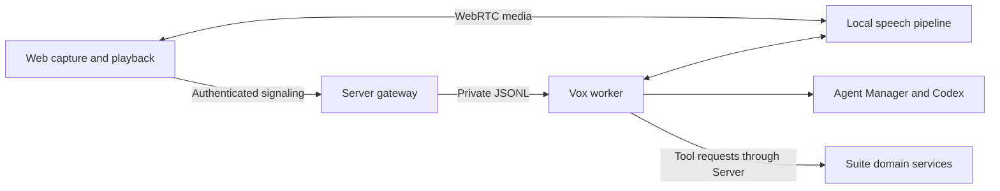

# Understand Vox

Vox translates live speech into a managed Codex conversation and streams replies into local speech synthesis. It is a source component with a private Python worker, not a public voice API. Server authenticates browser signaling and routes Suite tools; Web owns microphone capture, playback and the floating call interface.

**Current checkout:** controller startup and legacy Suite conversation tools have compatibility gaps. Read [implementation status](reference/implementation-status.md) before treating the source paths below as an operational call. Published alpha.3 downloads exclude Vox and voice runtimes according to the retained [component README](../README.md#when-to-use-vox).

## Reading paths

| Goal | Read in order |
| --- | --- |
| Understand the component | [Ownership](architecture/runtime.md), [audio and models](architecture/audio.md), [status](reference/implementation-status.md) |
| Change call handling | [Calls](lifecycles/calls.md), [turns and interrupts](lifecycles/turns.md), [worker protocol](reference/protocol.md) |
| Change hands-free controls | [Wake listener](lifecycles/wake.md), [audio](architecture/audio.md), [verification](development/verification.md) |
| Change agent integrations | [Controller and tools](integrations/controller.md), [status](reference/implementation-status.md), [verification](development/verification.md) |
| Prepare a development host | [Development](development/README.md), [configuration](reference/configuration.md) |

For an AI agent, trace the affected source owner and focused tests before editing. Local transcription does not imply a local model provider; a call-control event requests a browser action rather than proving it occurred.

Use the [first-call procedure](development/first-call.md) for the floating interface and a scoped human qualification check. The [component README](../README.md) preserves legacy anchors as navigation.
