# Audio and model boundaries

Call speech uses Pipecat to connect browser WebRTC media with local Whisper transcription and Kokoro synthesis. Codex is a separate text/tool adapter; it is not inserted as a Pipecat LLM service. Wake detection has its own input-only pipeline and does not load these speech engines.

```mermaid
flowchart LR
  accTitle: Call audio and text pipeline
  accDescr: Incoming 16 kilohertz audio passes through Silero VAD and Whisper into correlated speech segments. The voice buffer submits text to the session and Codex adapter. Agent deltas enter Kokoro and 24 kilohertz outgoing audio.
  In[WebRTC input 16 kHz] --> VAD[Silero VAD]
  VAD --> STT[Whisper]
  STT --> Bridge[Segment bridge and turn buffer]
  Bridge --> Session[Session and Codex adapter]
  Session -->|Text frames| TTS[Kokoro]
  TTS --> Out[WebRTC output 24 kHz]
```

## Model and resource contracts

| Boundary | Actual implementation | Consequence |
| --- | --- | --- |
| Whisper | Faster Whisper `WhisperModel`, default `base` / CPU / `int8` | Configurable; no automatic MLX selection in `speech.py` despite optional Darwin dependency |
| Inference threading | Lazy transcription generator consumed under a lock in the inference thread | Keeps VAD, interruption and utterance timers off the blocking inference path |
| Kokoro | Cached ONNX model/voices; default `af_heart` | Voice existence validated; preparation and inference separately serialized |
| Shared models | `_SpeechModels` serializes loading; Whisper key includes all three settings | New settings replace the cached Whisper reference; existing processors retain their engine |
| Per-call state | Fresh STT/TTS processors, VAD, bridge, queues, resamplers and WebRTC connection | Cached engines do not retain the call pipeline |
| VAD | Start and stop confirmations each 0.2 seconds | Turn buffer accounts for these delays, not just wall-clock silence |
| Pipeline | RTVI disabled; call worker idle timeout 600 seconds | Do not infer a public RTVI contract or a durable call |
| Reply output | Queue maxsize 256; dropped text frames emit playback-too-slow error | Visible text remains available; no automatic replay of missing audio |

`SpeechPipeline.start` loads speech services in a thread before initializing the peer. Closing during either stage prevents later pipeline startup. The sender waits for `on_pipeline_started` before pushing outgoing frames through the bridge. The greeting and idle background announcements use `TTSSpeakFrame`; streamed replies use response-start, text and response-end frames.

## Cleanup and memory

`close()` creates one shielded cleanup task, so overlapping calls and cancellation of an awaiting caller do not abort cleanup. It closes the turn buffer, cancels the pipeline, disconnects WebRTC, bounds runner waiting at five seconds, clears references and queued output, then collects reference cycles in a thread. Model engines remain warm. Wake cleanup is a separate implementation; do not assume it has the call pipeline's shared cleanup task.

The former README's numeric RAM/VRAM observations were removed because the environment and raw run provenance were not reproducible. They establish no current limits. [Capacity guidance](../../../../apps/server/docs/development/capacity.md) and the opt-in [six-call audio regression](../../tests/test_speech_audio.py) give measurement context; no new memory qualification was performed for these docs.

[Speech implementation](../../src/aixand_vox/speech.py), [speech unit tests](../../tests/test_speech.py), [turn buffering](../lifecycles/turns.md), [configuration](../reference/configuration.md).
