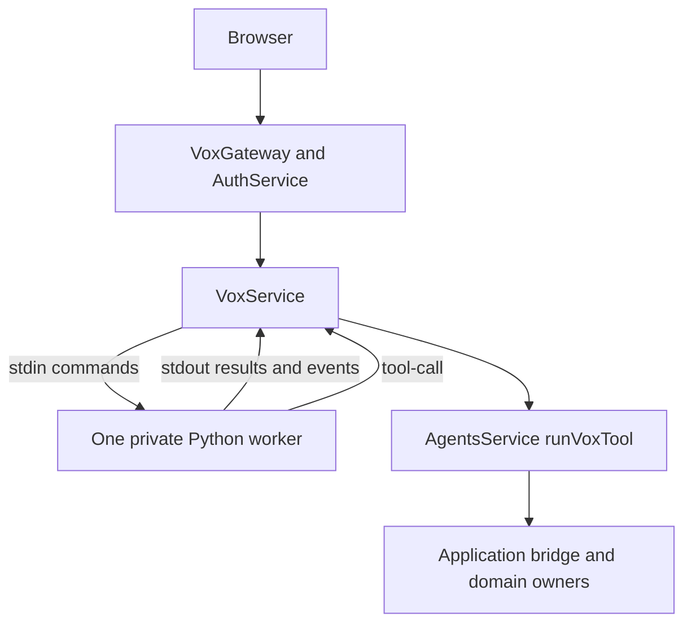

# Runtime and ownership

The Python worker coordinates ephemeral calls. It neither authenticates browsers nor opens an HTTP listener. NestJS owns the public authenticated WebSocket, and a generated private owner ID follows each command into the worker. Browser-provided owner fields are rejected by the strict gateway schema.

## Ownership map

| Owner | Retained state | Lifetime and boundary |
| --- | --- | --- |
| Web `useVox` | Session projection, media peers/tracks, mute flags, startup generations | Browser memory; pagehide/unmount releases both media paths |
| Gateway | Private owner UUID, pending/completed request cache | One authenticated socket; disconnect releases only its owner |
| VoxService | Worker process, startup promise, internal request IDs/timers | Server process; worker failure resolves pending requests with errors |
| Worker | `sessions`, `wakes`, pending tool futures, disconnected owners | Worker memory; no durable call resumption |
| Session | Eight queued messages, separate reply/voice generations, greeting and notification deduplication | One call, at most one per browser owner |
| Speech model cache | Whisper engine keyed by model/device/compute; Kokoro engine | Worker lifetime, independent of call processors |
| Agent Manager/provider | Profile authentication and controller thread/turn | External SDK authority; worker keeps IDs, not browser credentials |
| Suite application bridge | Projects, investigation records, conversation operations | Separate durable owner; accepted background work outlives audio |

The controller uses a worker-selected directory under `VOX_STATE_DIR`; the browser does not choose its filesystem path. Explicit project paths enter validated Suite tools, not the media protocol.

## Startup and teardown

VoxService lazily starts Python after capability and interpreter checks. `ready` means the JSONL worker is running; profile selection, controller creation and speech loading happen later. The service drains worker stderr without forwarding it to the browser. Preserve stdout for JSONL; do not assume stderr diagnostics are retained in Server logs.

EOF closes wakes and sessions. Server shutdown ends stdin, waits up to ten seconds and then kills the child. Socket disconnect sends an owner-scoped `disconnect`; that owner cannot start another session in the same worker. See [calls](../lifecycles/calls.md) for call versus media cleanup.

## Source and checks

[Worker](../../src/aixand_vox/worker.py), [gateway](../../../../apps/server/src/vox/vox.gateway.ts), [service](../../../../apps/server/src/vox/vox.service.ts), [module](../../../../apps/server/src/vox/vox.module.ts), [Web model](../../../../apps/web/src/vox/model.ts).

[Worker tests](../../tests/test_worker.py) cover owner/key routing and cancellation races. [Gateway tests](../../../../apps/server/test/vox.e2e-spec.ts) substitute VoxService and verify authentication, ownership and duplicate requests; they do not start speech or Codex.
