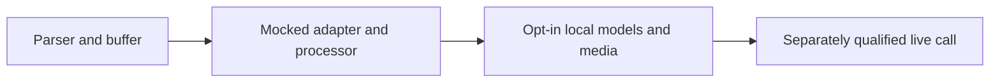

# Verify Vox boundaries

Choose checks by the changed owner. Default Python tests exercise parsers, buffering and mocked adapters/processors. Optional local audio tests exercise real cached models without paid model turns; browser and Server tests use fixtures at their own boundary.



## Commands and scope

From `services/vox` after locked setup:

```sh
uv run --locked python -m unittest discover -s tests -v
```

Dependency-free focused checks can avoid SDK imports:

```sh
PYTHONPATH=src python3 -B -m unittest discover -s tests -p test_controls.py -v
PYTHONPATH=src python3 -B -m unittest discover -s tests -p test_turns.py -v
```

| Test file | Meaningful assertions |
| --- | --- |
| [test_controls.py](../../tests/test_controls.py) | Exact commands bypass model; ordinary mentions do not trigger |
| [test_turns.py](../../tests/test_turns.py) | Pause/correction coalescing, pending final STT, failure discard, bounded transcript and close |
| [test_codex.py](../../tests/test_codex.py) | Profile/auth identity, restricted launch, stale turn rejection, cancellation terminal barrier, tool correlation |
| [test_worker.py](../../tests/test_worker.py) | Greeting once, input-source metadata, generations, accepted background work, owner-scoped wake |
| [test_speech.py](../../tests/test_speech.py) | Engine reuse/load serialization, inference threading, segment completion ordering and cleanup races |
| [test_wake_diagnostics.py](../../tests/test_wake_diagnostics.py) | Debug metrics and cooldown, debug-off behavior and pipeline failure reporting |
| [test_speech_audio.py](../../tests/test_speech_audio.py) | Six real local WebRTC call cycles, shared engines, audible output, Linux ended-call RSS growth bound |
| [test_wake_audio.py](../../tests/test_wake_audio.py) | Kokoro-generated voices, false positives, seeded noise and quiet keyword detection |

Opt-in commands require prepared local models and dependencies:

```sh
VOX_TEST_SPEECH_AUDIO=1 uv run --locked python -m unittest discover -s tests -p test_speech_audio.py -v
VOX_TEST_WAKE_AUDIO=1 uv run --locked python -m unittest discover -s tests -p test_wake_audio.py -v
```

These audio checks can access model caches; do not run them as an offline proof without checking preparation first. Synthetic voices are not human accent/noise coverage. The speech regression does not start a Codex turn and its Linux growth assertion is not a whole-Suite RAM requirement.

## Integration verification and known evidence

[Gateway test](../../../../apps/server/test/vox.e2e-spec.ts) verifies auth, strict schemas, private owner routing and duplicate starts with a substituted service. [Voice fixtures](../../../../apps/web/tests/voice.spec.ts) and [conversation fixtures](../../../../apps/web/tests/vox-conversations.spec.ts) cover UI/control/link behavior. These were inspected, not executed for this documentation change.

Documentation authoring checks on 2026-11-17 passed all two control tests and eight buffer tests using `python3 -B`. An attempt at the complete suite using the existing `.venv` failed adapter import (`agent_manager.profiles.select_profile` absent), then stalled during the speech responsiveness test and was interrupted. The environment identified Pipecat 1.12.0 while project metadata pins 1.16.0. It is not a clean locked-environment test result. No environment repair, package sync, model download, real microphone or live provider call was performed.

A later live qualification should record OS/browser, selected host and SDK versions, capability response, interpreter, profile/auth mapping, cached models, greeting, visible STT, a read-only provider reply, interruption terminal behavior, reconnect/cleanup and wake-offline release. Resolve [current integration gaps](../reference/implementation-status.md) first; do not diagnose a missing controller as a microphone failure.
