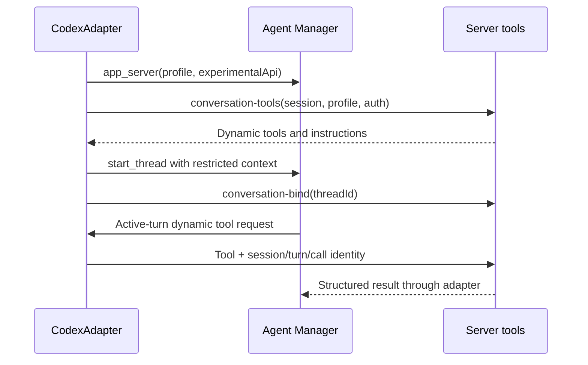

# Controller and Suite tool integrations

`CodexAdapter` uses Agent Manager's managed app-server protocol for text and tools. It selects a requested Codex profile or calls `select_profile`, captures the managed authentication identity and rechecks that identity before each send. Speech engines run locally; the selected provider remains a separate execution and credential boundary.

This is the adapter's implemented protocol intent, not a successful end-to-end path in this checkout. See [implementation status](../reference/implementation-status.md) for the missing legacy Server attributes and observed SDK import failure.

## Controller restrictions

| Setting or request | Contract |
| --- | --- |
| Working directory | `VOX_STATE_DIR/conversations/<session UUID>`; created mode 0700, project unset |
| MCP | `inherit: false`; explicit dynamic `aixand_vox` plus returned shared toolset |
| Launch | `approvalPolicy: on-request`, sandbox `read-only`; optional `VOX_MODEL` |
| Permissions approval | Respond with empty permissions, scoped to turn |
| Other approval requests | Decline; MCP elicitation declined |
| Structured user questions | Respond with instruction to ask in spoken conversational reply |
| Native tool calls | Namespace and advertised name allowlist; active completion and turn ID required |
| Result | JSON in inputText; status `uncertain` or `failed` sets tool response success false |

Read-only controller sandboxing does not make all dynamic tools read-only. Project registration, explicit follow-ups and task launches have their own validated effects. Tool results/background updates are data, not instructions. No browser operation can directly invoke `vox-tool` through the gateway.

## Tool families and durable owners

| Family | Tools / operation | Owning boundary |
| --- | --- | --- |
| Projects | `list_projects`, `add_project`, `remove_project` | Existing Suite registry; removal preserves files and chats |
| Discovery | `discover_projects`, `get_project_discovery`, `filter_project_discovery`, `add_discovered_projects`, `cancel_project_discovery` | Backend jobs scoped to Vox origin; filtering changes a view, not registration |
| Profiles | `inspect_profiles` | Agent Manager allowance/auth observations |
| Investigations | `start_investigation`, `get_task_status`, `stop_task`, `list_tasks` | Server `vox_tasks` records plus separate Suite chat |
| Call control | `control_call` | Session validates exact action and emits browser event locally |
| Conversation namespace | Returned names such as `search_chats`, `read_chat`, `send_chat_message`, `get_chat_message_status` | Retained shared contract; actual legacy service missing |

[Native definitions](../../src/aixand_vox/codex.py) retain full JSON schemas. [Server VoxTools](../../../../apps/server/agent-bridge/vox_tools.py) validates application arguments and routes project calls with origin/turn/call identity. [Shared JSON](../../../../apps/server/agent-bridge/conversation_tools.json) and [Server conversation reference](../../../../apps/server/docs/integrations/conversation-tools.md) retain the search/read/send contracts and explicit implementation caveat; do not substitute normalized Conversation Manager tools silently.

## Investigation and notification contracts

The retained VoxTools launch code derives a UUID5 from session, source turn, project and instruction, saves phases before create/send, and reuses an existing record for the same identity. Separate investigation chats request read-only access and disable workspace tools. Phases are `prepared`, `creating`, `created`, `starting`, `started`, `failed` or `uncertain`. Restart reconciliation checks for a retained turn; intermediate launch uncertainty is not permission to relaunch.

Session task events match `sessionId`; terminal status changes produce brief announcements and retain up to ten updates for the next prompt. Discovery events match exact Vox origin and increasing revision; repeated identical terminal announcements are suppressed. Speech occurs only when idle, so a background completion does not interrupt an active reply. These event handlers are unit-tested independently of the broken legacy bridge integration.

[Adapter tests](../../tests/test_codex.py), [notification tests](../../tests/test_worker.py), [Web conversation-link fixtures](../../../../apps/web/tests/vox-conversations.spec.ts), [current chat owner](../../../../apps/server/agent-bridge/application/chats.py).

## Retained discovery and conversation examples

The examples below describe the legacy tool/UI contract only. Current SuiteChats compatibility blocks this walkthrough; schema presence does not establish execution.

The retained discovery contract can discover projects under an explicitly supplied local directory and add
them to the existing Suite project registry. Say “Discover all my projects under
`~/projects` and add them.” Discovery alone previews candidates; explicit addition
registers recommended roots without a second confirmation. Nested packages are
optional. The existing `aixand_vox` native tools start a saved backend job, inspect
results, import selected candidate IDs, or cancel scanning. Completion is announced
once when the call is idle, and detailed results remain in **Discover projects**
after the call ends. Interrupted controller turns discard new tool requests;
already accepted discovery jobs continue independently.

Vox can also find saved Suite chats, read their messages and parent/child threads,
and send an explicit follow-up into an existing conversation. Normal Codex chats
have the same tools. Say “Find the recent Undercurrent audit chat,” then “Send the
parent chat a request to turn the findings into an implementation plan.” Vox shows
clickable conversation links in both its panel and minimized call updates. Busy
destinations queue messages; delivery receipts distinguish acceptance from the
destination's completed reply. See the server's
[shared conversation tools](../../../../apps/server/docs/integrations/conversation-tools.md) for scope,
thread relationships, delivery recovery, and MCP/native transports.

To register an existing directory directly, say “Add `/absolute/path/to/notes` as
a project named Research notes.” `add_project(name, path)` uses the same registry
as manual Web registration and accepts `~/…` paths. It works without Git or build
manifests and leaves the directory untouched. Repeating the same name/path reuses
the saved project. Explicit `.aixand/project.json` markers also identify roots in
discovery; Suite's marker groups all five components beneath `aixand-suite`.

Say “Remove Research notes from my projects” to use `remove_project(projectId)`.
Vox resolves the exact saved project by name or path with `list_projects`; ambiguous
matches require clarification. Removal unregisters only that ID, preserving its
files, existing chats, aliases, and child registrations. Saved discovery results
refresh their live registration status, and repeat requests safely reuse the outcome.

Follow up with “Only show project roots, not all their crates” to use
`filter_project_discovery` on the same saved job/card. Roots, name/path queries,
and specific candidate IDs can narrow its results without rescanning or changing
registered projects. Filters combine and replace the previous view; scope `all`
with no query/IDs restores all results. `get_project_discovery` pages the filtered
view. If asked to add only those shown, `add_discovered_projects` uses selection
`filtered`; its default recommended selection still refers to the full scan.
