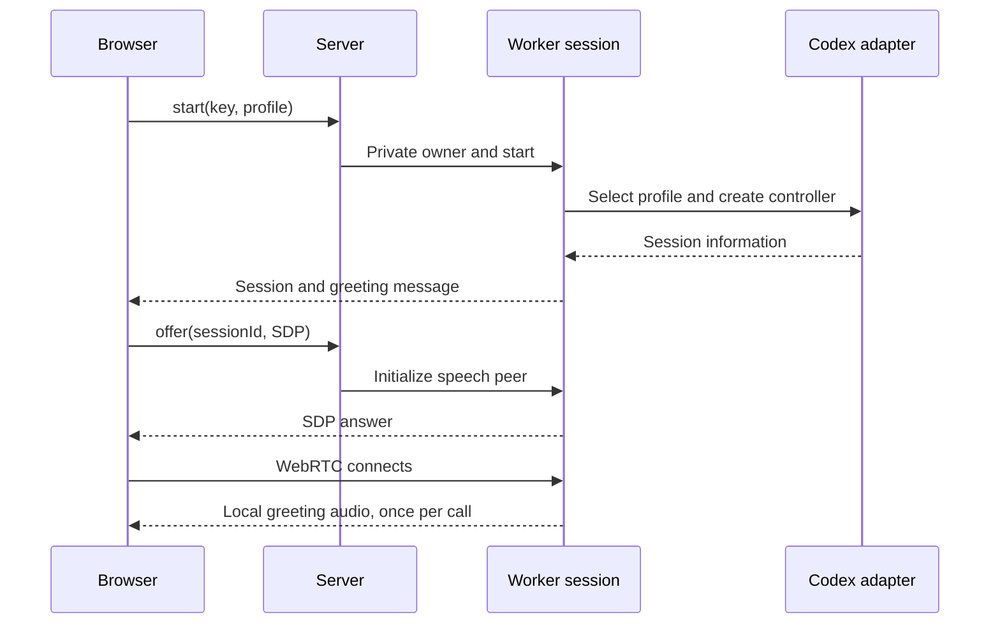

# Call and media lifecycle

A session and its audio connection are independent. Starting the controller returns session/profile/auth/model information and a greeting message; offering media later creates speech processors. Typed input can remain usable when the microphone disconnects, provided the controller and signaling connection remain healthy.

## State and transitions

| Trigger | Worker effect | Browser responsibility |
| --- | --- | --- |
| `start` | Validate UUID, reserve one session per owner, create controller; failure closes/removes it | Guard duplicate startup with generation/key; display returned greeting |
| `offer` | Reject second active pipeline; load models and return answer | Capture audio, gather ICE, apply answer; generation checks discard stale completion |
| Peer connected | Set `audio_connected`; speak greeting only once | Enable call tracks according to mute flag |
| `text` | Accept into bounded queue or execute exact control locally | Acceptance means queued, not replied |
| `audio-stop` or peer loss | Close speech pipeline; retain session | Stop tracks, close peer, clear audio element; reconnect audio or type |
| `end` | Mark closed, stop audio, close adapter, cancel processor, emit `ended`, remove session | Release call media; auto-call can remain enabled |
| Socket loss / page exit | Owner-scoped disconnect closes its session and wake listener | Release both media paths; restart rather than resume |

The Web call stream clones an existing wake stream when available, but uses a separate peer and independently enabled tracks. Secure context and `getUserMedia` checks live in Web. Browser autoplay rejection offers explicit playback retry; it does not imply server synthesis failed.

## Presentation versus retained context

Web shows only the newest user/reply exchange, including streamed updates and background announcements. The controller thread retains previous turns for model context. Hiding/minimizing the panel does not end the call. Startup/ending phases disable conflicting UI actions; phases such as `listening`, `thinking` and `ready` are observations rather than durable job states.

The greeting checks local playback and peer setup. It does not send an LLM turn or prove tool/provider availability. In this checkout controller startup may fail earlier at the [compatibility gaps](../reference/implementation-status.md).

[Session source](../../src/aixand_vox/worker.py), [Web lifecycle](../../../../apps/web/src/vox/model.ts), [presentation](../../../../apps/web/src/vox/Vox.tsx), [greeting/race tests](../../tests/test_worker.py), [Web fixtures](../../../../apps/web/tests/voice.spec.ts).
