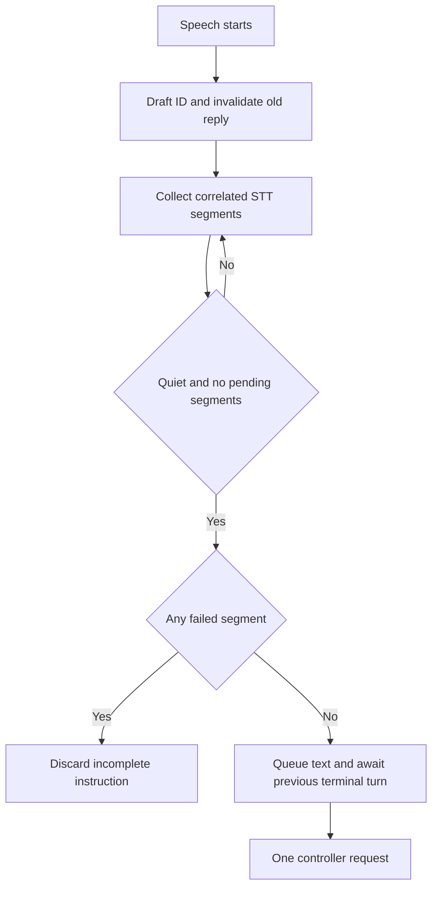

# Spoken turns and interruption

A spoken instruction may contain several VAD segments. Vox waits for every final STT result and the quiet deadline before dispatching it once. Speaking also invalidates the previous reply synchronously, before awaited playback or provider interruption calls.

## Buffer and generation rules

| Mechanism | Invariant |
| --- | --- |
| Draft UUID | All partial transcript updates replace one user message |
| Segment IDs | `VoiceSegmentQueuedFrame` registers pending work; transcription carries `voxSegmentId` |
| Finished marker | A data frame follows its transcript in order, including empty/error results; a system frame could overtake text |
| Deadline | At VAD stop: now + max(0, pause + start confirmation − VAD silence) |
| Resume | Cancel timer and preserve draft; late old STT cannot commit while speaking |
| Failure | Any failed segment poisons the entire draft; no partial instruction is sent |
| Bound | Joined transcript truncates to 16,000 characters |
| Reply generation | Incremented synchronously on interrupt; old callbacks cannot emit text or queue speech |
| Voice generation | Incremented separately; remove queued voice inputs, retain typed inputs; obsolete voice entries are skipped |
| Serialization | Session waits for input-idle and interruption; adapter lock admits only one `ask` |

`VOX_SPEECH_PAUSE_SECONDS` defaults to 1.0 (finite range 0.5–5). Closing the buffer cancels the timer, drops pending segments and signals empty voice completion to release the session's input wait.

## Native cancellation is a separate barrier

The adapter tracks thread ID, active turn ID and the completion future. It ignores other threads/turns, suppresses interrupted deltas and rejects new dynamic tool calls after interruption. Already dispatched tools can finish; speech interruption never cancels accepted investigations or discovery jobs.

| Condition | Action |
| --- | --- |
| Interrupt before turn ID arrives | Mark intent; interrupt when `turn/started` supplies ID |
| Interrupt RPC acknowledges | Continue waiting for matching `turn/completed` |
| Terminal completion arrives | Allow the next queued instruction |
| No terminal confirmation within ten seconds after cancellation | Mark adapter unsettled; refuse subsequent turns; end/restart call |
| No completion during normal wait | 180-second wait expires; mark unsettled and attempt bounded interrupt |
| Saved profile authentication changes | Refuse send; require new conversation |

The speech layer suppresses output, drains pending frames and pushes `InterruptionFrame`. Muting a speaker is different: it changes browser playback without interrupting the controller.

[Turn buffer](../../src/aixand_vox/turns.py), [session generation logic](../../src/aixand_vox/worker.py), [adapter](../../src/aixand_vox/codex.py), [buffer tests](../../tests/test_turns.py), [adapter correlation tests](../../tests/test_codex.py), [session tests](../../tests/test_worker.py).
