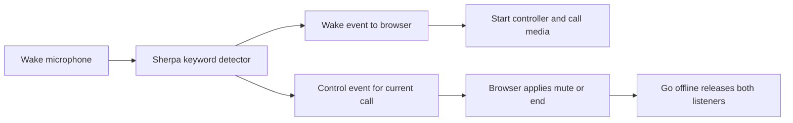

# Wake listener and local controls

Auto-call creates an independent input-only WebRTC pipeline. Sherpa ONNX detects a small English keyword set on CPU; idle wake listening does not start Whisper, Kokoro or a Codex turn. Web owns the permission and media track lifecycle, while Worker binds each listener key to one private socket owner.

## Keyword contract

| Phrase | Action |
| --- | --- |
| Hey Vox | `wake`; ignored for an already active session |
| Vox mute / Vox unmute | `mute_microphone` / `unmute_microphone` |
| Vox end / Vox end call | `end_call` |
| Vox go offline | `go_offline` |

The pinned model is `sherpa-onnx-kws-zipformer-gigaspeech-3.3M-2024-01-01`, configuration `vox-wake-english-v2`, threshold 0.25 and one trailing blank. Keywords use precomputed English BPE tokens; runtime has no tokenizer. The processor normalizes int16 samples and debounces each action for more than 1.5 seconds. A detection resets the detector stream.

## Capture and identity

| Case | Behavior |
| --- | --- |
| Call microphone muted | Only call tracks disabled; keyword capture remains available |
| Auto-call disabled | Stop wake tracks and peer; active call may continue |
| End call | Call closes; wake can remain ready |
| Go offline | Request wake-stop and end; release both captures |
| Pagehide/unmount/socket close | Release both locally; Server disconnect cleans owner resources |
| Stale key / dead owner | Ignore stale events or reject debug operations; canceled setup cannot remove a replacement listener |
| Browser reload/suspension | Auto-call is not restored; a closed or sleeping tab cannot hear a wake phrase |

Exact call phrases in typed or transcribed input also use [controls.py](../../src/aixand_vox/controls.py), bypassing the queue and model. This parser is broader than the acoustic keyword set: it includes speaker controls and natural complete phrases. Ambiguous bare words such as unprefixed `mute` are deliberately not commands. `control_call` offers the same six action values to the controller and requires exactly one `action` argument. The worker emits the requested action; Web applies it.

## Model preparation and diagnostics

[Wake model preparation](../../src/aixand_vox/wake_model.py) checks a pinned archive SHA256, a 64 MiB download cap and regular named members up to 16 MiB each. Files live in a model-version subdirectory; existing cache files are checked for presence, not rehashed. Preparation writes the keyword file each time. [prepare.py](../../src/aixand_vox/prepare.py) prepares wake files after loading speech services; it does not warm a detector instance.

Debug-only metrics distinguish missing frames, silence and audible levels without retaining PCM. Five-second monitoring can be toggled without disconnecting wake capture. Pipeline failure emits error/disconnected events; re-enable listening after failure.

[Wake pipeline](../../src/aixand_vox/wake.py), [ownership tests](../../tests/test_worker.py), [diagnostic tests](../../tests/test_wake_diagnostics.py), [parser tests](../../tests/test_controls.py), [opt-in synthesized audio tests](../../tests/test_wake_audio.py).

## Enable the retained browser control

After resolving the [controller compatibility gaps](../reference/implementation-status.md), open the phone bubble and enable **Auto-call · Hey Vox**. This is off by default and requires microphone permission. The amber indicator represents the separate wake listener, including while the call microphone is muted. Keep the tab open and awake. The speaker button controls playback separately.
