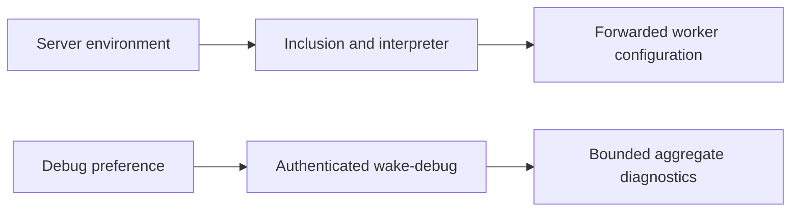

# Configuration and diagnostics

Server deliberately constructs the worker environment instead of forwarding all variables. Configure the Server process and restart it after changes; browser inputs never select worker executables, model directories or controller working paths.

## Relevant settings

| Variable | Default / use | Owner |
| --- | --- | --- |
| `AIXAND_VOICE_ENABLED` | Explicit `1`, or absent in nonpackaged development | Server inclusion gate |
| `VOX_PYTHON` | Resolved `../../services/vox/.venv/bin/python` from Server cwd | Server spawn; not passed as worker setting |
| `VOX_STATE_DIR` | `~/.local/state/aixand/vox` | Controller directories under `conversations/<UUID>` |
| `VOX_MODEL` | Omitted, provider chooses | Controller thread model override |
| `VOX_WHISPER_MODEL` | `base` | Faster Whisper weights |
| `VOX_WHISPER_DEVICE` | `cpu` | Whisper device selection |
| `VOX_WHISPER_COMPUTE` | `int8` | Whisper compute type |
| `VOX_TTS_VOICE` | `af_heart` | Kokoro voice; must exist |
| `VOX_SPEECH_PAUSE_SECONDS` | `1.0`; finite 0.5–5 | Spoken instruction commit delay |
| `VOX_ICE_SERVERS` | Empty; comma-separated trimmed entries | Python call and wake peers; Web creates default peers |
| `VOX_WAKE_MODEL_DIR` | `~/.cache/aixand/vox/wake` | Versioned keyword model directory |
| `HF_HOME`, `HF_HUB_OFFLINE` | Inherited only if configured | Model library cache/offline behavior |

[VoxService](../../../../apps/server/src/vox/vox.service.ts) also forwards selected Agent/Server/MCP/Prompt/Skill Manager, Undercurrent, XDG and working-directory settings. Read its explicit allowlist before adding a setting. Development PYTHONPATH includes Vox and optional manager/runtime source overrides; packaged runtime clears PYTHONPATH and disables user site and bytecode writes. [Platform environment](../../../../apps/server/src/platform-environment.ts) supplies platform basics.

## Diagnostics contract

| Signal | Evidence and limit |
| --- | --- |
| Startup timing | `starting`, `profile-selected`, `agent-connected`, `conversation-tools-ready`, `conversation-created`, `ready`; elapsed milliseconds from adapter startup |
| Web peer/track state | ICE/signaling/capture milestones and autoplay errors; no raw SDP/device IDs |
| Wake audio | Debug-only frames, sample rate/channels, RMS/peak, duration, detections and decode time; five-second reports |
| Web report | `vox-diagnostics-v1`; 200 events, 128 KiB rolling buffer, 256 KiB export, 4096-byte event cap |
| Debug disabled | Clear buffers and remove window exporter; stop monitoring without disconnecting keyword capture |

[diagnostics.ts](../../../../apps/web/src/vox/diagnostics.ts) records bounded metadata, not audio, credentials or conversation content. Settings → Debug mode exposes Voice diagnostics → Copy diagnostics and `window.aixandVoxDiagnostics.export()`. Browser route statistics retain candidate types/protocol rather than addresses. [Wake diagnostics tests](../../tests/test_wake_diagnostics.py) distinguish missing/silent/audible data with synthetic PCM; that does not measure a real microphone here.

## Failure and recovery map

| Failure | Next evidence / recovery |
| --- | --- |
| Feature hidden | Check both capability booleans, inclusion and interpreter presence |
| Worker cannot start | Inspect interpreter/import compatibility; ready is not a model warmup |
| Controller/tool discovery fails | Check captured profile auth and legacy integration mismatch |
| Media offer fails | Check secure context, permission, cached models and ICE; typed path can remain available |
| Playback blocked | Use explicit playback retry in Web |
| Audio peer lost | Stop audio, retain controller; reconnect microphone or type |
| Cancellation unconfirmed | End/restart controller; inspect background tasks before relaunch |
| Tool delivery timeout/worker exit | Treat outcome as uncertain; inspect durable owner records |
| Wake disconnected | Re-enable auto-call; offline/page exit releases both captures |

[Status](implementation-status.md), [protocol](protocol.md), [focused verification](../development/verification.md).
