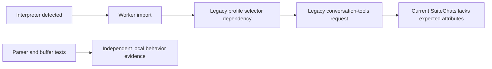

# Implementation status and qualification gaps

This map describes inspected source and authoring-time checks, not an enabled release or a verified provider integration. The component README now forwards to scoped guides; current SDK and Server compatibility must be resolved before asserting working end-to-end calls.

## Coverage and gaps

| Area | Source evidence | Status / limit |
| --- | --- | --- |
| Private worker | All nine package files inspected, including package initializer and preparation CLI | JSONL worker, no public Python listener or credential input |
| Call/turn state | Queue, segment buffer, generations, terminal barrier and cleanup implemented | Unit fixtures cover important races; full suite not passed here |
| Speech | Local Faster Whisper/Kokoro; fresh processors and shared native weights | No new audio/memory qualification; optional Darwin MLX package does not change explicit Faster Whisper path |
| Wake | CPU keyword pipeline, checksummed download, independent owner/key and debug state | No new real or synthesized acoustic run performed |
| Agent Manager API | `codex.py` imports `select_profile` from `agent_manager.profiles` | Existing environment raises ImportError: selector absent; prevents importing worker/adapter |
| Dependency environment | `pyproject.toml` pins Pipecat 1.16.0 | Existing `.venv` reports 1.12.0; tests are not locked-environment qualification |
| Conversation startup | Adapter always requests `conversation-tools` before thread creation | Server VoxTools expects `chats.conversation_module`, `chats.conversations`; current SuiteChats defines neither |
| Other legacy tool paths | VoxTools also expects legacy project-tool argument surface and chat operations | Presence of schemas/dispatch is not compatibility with current normalized chat implementation |
| Shared conversation contract | JSON and reference docs retained; Web renders returned links | Legacy service/stdio adapter absent; normalized Orchestration MCP is a different boundary |
| Durable investigations | VoxTools retains phases/idempotency and restart reconciliation logic | Not verified reachable through current controller/bridge; do not promise end-to-end launches |
| Capability detection | Interpreter existence and inclusion gates only | No SDK/model/tool readiness check |
| Release | README explicitly excludes voice/Vox from alpha.3 downloads | Source setup is a separate qualification path |

## Required follow-through before operational claims

1. Align the installed SDK and locked dependency environment with the adapter API, or migrate the adapter deliberately.
2. Trace and migrate the Server VoxTools contract into current SuiteChats/Conversation Manager ownership. Preserve exact receipt, origin and uncertainty semantics; an empty shared toolset is not a documented fallback.
3. Run mocked Python and gateway/Web checks in that environment, then optional cached local audio checks.
4. Separately record a real browser microphone/provider call and interruption/cleanup evidence on the target host. Do not infer success from UI visibility or greeting alone.

For this documentation task, two parser tests and eight turn-buffer tests passed. Full discovery was attempted, hit an adapter import error, then stalled in a speech threading test and was interrupted; no complete pass is claimed. The direct adapter-import probe reproduced the exact selector ImportError. No permissions were increased, no service changed, and no model/provider network calls were made.

[Adapter dependency](../../src/aixand_vox/codex.py), [Server tool adapter](../../../../apps/server/agent-bridge/vox_tools.py), [current SuiteChats](../../../../apps/server/agent-bridge/application/chats.py), [Server status](../../../../apps/server/docs/implementation-status.md), [shared reference caveat](../../../../apps/server/docs/integrations/conversation-tools.md#implementation-status), [verification](../development/verification.md).
