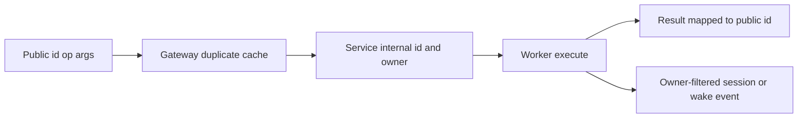

# Signaling and worker protocol

The public endpoint is authenticated `/api/vox/ws`. It carries JSON control and events, not PCM. The private worker reads newline-delimited JSON on stdin and emits JSONL on stdout. Server generates private owner IDs and replaces browser request IDs with internal correlation IDs before dispatch.

## Public operation contract

Every request is a strict object `{id, op, args}` with UUID `id`. Session IDs and wake/start keys are UUIDs; unknown fields close the socket.

| Operation | Arguments | Meaning |
| --- | --- | --- |
| `start` | `key`, required nullable `profile` | Reserve controller call; profile regex/length validated |
| `text` | `sessionId`, trimmed text 1–16000 chars | Queue instruction or execute exact control |
| `offer` | `sessionId`, type `offer`, SDP starting `v=0`, max 48000 chars | Connect call media |
| `audio-stop` / `interrupt` / `end` | `sessionId` | Stop media / reply / session respectively |
| `wake-offer` | `key`, type `offer`, SDP, optional boolean `debug` | Separate input-only peer |
| `wake-stop` | `key` | Stop matching listener; stale key leaves replacement intact |
| `wake-debug` | `key`, boolean `enabled` | Toggle metrics on matching live listener |

Private-only `disconnect` releases owner resources. `tool-result`, `task-event` and `discovery-event` enter through trusted worker stdin, not the public gateway schema.

## Messages and limits

| Layer | Contract |
| --- | --- |
| Gateway | Four connected sockets; payload 64 KiB; eight pending requests; at most 4096 completed request entries per connection |
| Duplicate ID | Completed identical request returns cached response; changed signature closes 1008; duplicate pending request returns busy error |
| Heartbeat | Ping every 15 seconds; terminate when prior ping lacks pong |
| Slow consumer | Close 1013 beyond 2 MiB socket output buffering |
| Service | At most 16 pending requests and 256 KiB stdin writable backlog; 4 MiB stdout buffer cap |
| Service timing | Worker startup 15 seconds; offers 240 seconds; other requests 120 seconds |
| Web timing | Offers 245 seconds; other requests 125 seconds; max eight pending, 128 KiB socket backlog |
| Worker input | Read at most 65537 bytes; over 65536 or missing newline ends loop |
| Worker jobs | Commands rejected busy at 32 active jobs; task/discovery event jobs also share that set |
| Session | Message queue maxsize eight; tool-result wait 190 seconds |

Worker messages include `ready`, correlated `result`/`error`, `fatal`, `event` (owner/sessionId/event), `wake-event` (owner/key/event), and private `tool-call` (id/args). Session event kinds include message/delta, phase, audio, startup-timing, tool, task, discovery, control, error and ended. The gateway removes private owner before delivery. Text acceptance and interrupt RPC acknowledgment are not terminal turn evidence.

Timeouts leave outcomes unconfirmed. End the conversation and inspect accepted task/discovery state before repeating mutations; a new socket does not retain the gateway's duplicate cache. The worker is not a resumable call store.

[Strict gateway schema](../../../../apps/server/src/vox/vox.gateway.ts), [service framing](../../../../apps/server/src/vox/vox.service.ts), [worker dispatch](../../src/aixand_vox/worker.py), [Web connection](../../../../apps/web/src/vox/model.ts), [turn terminal contract](../lifecycles/turns.md).
