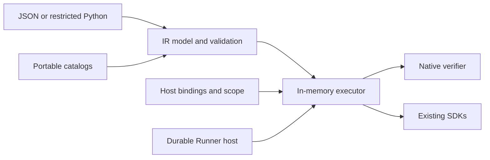

# Workflow IR

IR defines portable, versioned workflow documents and executes exact operation contracts through host-installed bindings. Its Rust core owns the document and type rules; its executor owns in-memory invocation and scope handling. The separate Runner service owns durable jobs, storage and recovery.

## Reading paths

| Goal | Read in order |
| --- | --- |
| Understand the component | [Composition](architecture/composition.md), [document model](architecture/model.md), [types](architecture/types.md) |
| Change validation | [Validation boundaries](validation.md), [v0.1 specification](specification.md), [v0.2 extension](branching-v0.2.md) |
| Embed execution | [Execution](lifecycles/execution.md), [scope ownership](lifecycles/scopes.md), [SDK boundary](integrations/sdk.md) |
| Extend compilation | [Python frontend](integrations/frontend.md), [compiler guide](../examples/python/README.md) |
| Verify or release | [Development](development.md), [conformance map](conformance.md), [distribution](distribution.md) |

## Contracts to keep separate

| Artifact or observation | Establishes |
| --- | --- |
| Workflow `ir_version` 0.1 / 0.2 | Document semantics; 0.2 adds branches and pure boolean expressions |
| Catalog `contract_version` 0.1 | Portable contract format, independent of workflow version |
| Exact operation ID and version | Contract selection; no code discovery or version-range resolution |
| Crate version | Build/release identity, currently `0.1.0-alpha.1` in [Cargo.toml](../Cargo.toml) |
| Valid document | Structure and catalog semantics; executable bindings and runtime inputs still need preparation |
| Operation completes | Its catalog-defined boundary; agent readiness, message delivery and application answers differ |
| Executor `Completed` event | Workflow outputs evaluated; owning-scope cleanup can still fail |

The [source README](../README.md) retains installation and embedding commands. Existing references remain in place: [decisions](decisions.md), [branching implementation](branching-implementation.md), [specification](specification.md), [conformance](conformance.md). Current differences from historical coverage claims are recorded in [composition](architecture/composition.md#implementation-status).
