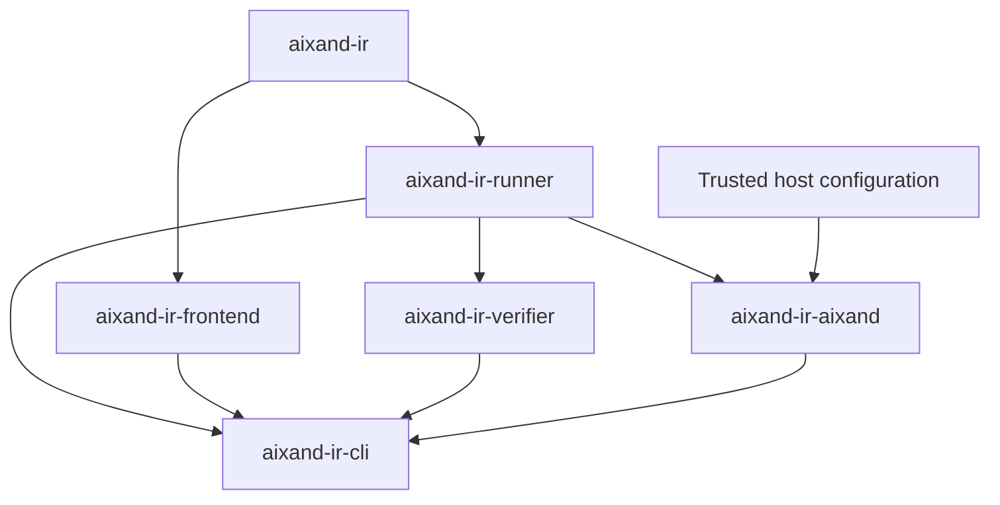

# Composition and authority

The six-crate workspace separates portable contracts from implementations. A catalog can validate an invocation without granting authority to run it. Host code selects bindings and runtime configuration; workflow text never selects arbitrary executable modules.

Arrows show foundations feeding consumers, not runtime call order.

## Ownership map

| Owner | State and responsibility | Entry point |
| --- | --- | --- |
| Core | Closed records, portable JSON, schemas, catalogs, directional types, pure evaluation and visibility | [lib.rs](../../crates/aixand-ir/src/lib.rs) |
| In-memory executor | Binding preparation, ordered blocks, host graph APIs, publication, cancellation and scope cleanup | [runner.rs](../../crates/aixand-ir-runner/src/runner.rs) |
| Verifier | Data-only document checks through the public `Binding` trait | [lib.rs](../../crates/aixand-ir-verifier/src/lib.rs) |
| SDK adapter | Native SDK object retention, asyncio dispatch and selected snapshots | [lib.rs](../../crates/aixand-ir-aixand/src/lib.rs) |
| Frontend | Restricted AST compilation and frontend-only API mappings | [lib.rs](../../crates/aixand-ir-frontend/src/lib.rs) |
| CLI | File I/O, command selection, catalog composition, optional SDK/frontend features | [main.rs](../../crates/aixand-ir-cli/src/main.rs) |
| Separate Runner service | Durable submissions, graph revisions, persistence and recovery outside this component | [Runner README](../../../runner/README.md) |
| SDKs and services | Agent readiness, receipt affinity, messaging journals and process supervision | [Suite Python SDK README](../../../../sdks/python/README.md) |

Core and executor have no Python/SDK dependency. Frontend uses CPython's parser through PyO3 but does not import the workflow's modules. Adapter uses the existing SDK composition rather than recreating readiness or messaging infrastructure.

## Implementation status

| Area | Current source boundary | Reference caveat |
| --- | --- | --- |
| 0.1 sequences | Supported, original format preserved | v0.1 non-goals are version-specific |
| 0.2 conditionals | Nested branches and boolean expressions supported | [decisions](../decisions.md) says no branching because it records ratified v0.1 choices |
| Host graphs | `run_graph_json`, `run_graph_controlled`, `GraphControl` exist; independent operations can overlap | These are host APIs, not new portable DAG fields; old no-scheduler statements do not describe the entire current API |
| Web editing | Existing recursive editor and bridge consume IR | The final paragraph of [conformance](../conformance.md) retains an older no-visual-editor statement; see [branching implementation](../branching-implementation.md) |
| Catalog breadth | Read actual exact identities in [Aixand catalog](../../crates/aixand-ir/catalogs/aixand.json) | The historical conformance table's operation count is not a current inventory |
| Installed applications | Host allowlist maps application names to async Python entrypoints | Trusted host executable configuration; not portable code loading |
| Unsupported portable constructs | Loops, parallel blocks, branch results/merges, catch/retry, streaming, persistence and resource serialization | Application coroutines and host scheduling do not add these constructs to the IR schema |

These pages document inspected source, not a new qualification of live integrations. The preserved specifications remain the exact language references. Tests for the graph host integration are in the separate [Runner graph suite](../../../runner/tests/graph.rs); core/executor tests alone do not establish durable recovery.
