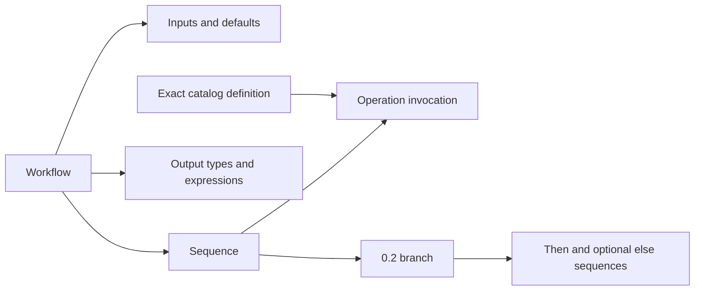

# Document model and serialization

A workflow declares inputs, one root sequence and outputs evaluated after the body succeeds. Operation definitions live in selected catalogs; invocations carry exact identities and input expressions, never their own output declarations.

## Record contracts

| Record | Required content | Constraint |
| --- | --- | --- |
| Workflow | `ir_version`, `inputs`, `body`, `outputs` | Optional `name` and `description`; unknown fields rejected |
| Sequence | `kind: sequence`, ordered `steps` | Empty valid; a bare sequence cannot be a step |
| Operation | `kind: operation`, `id`, `operation`, `inputs` | Global invocation ID; exact catalog identity |
| Branch, 0.2 | `kind: branch`, `id`, `condition`, `then` | `else` may be omitted but cannot be null; no outputs or operation identity |
| Workflow input | `type`, optional data `default` | No default means required at entry |
| Workflow output | `type`, `value` | Evaluated only after all selected body work succeeds |
| Catalog | `contract_version`, `package`, `operations` | Package/version and operation/version are independent |
| Operation input | `type`, `required`, optional data `default` | Required inputs cannot have defaults; absent optional input without default stays absent |
| Operation output | `type` | Every declared port required on success; unavailable values need a nullable type |

[model.rs](../../crates/aixand-ir/src/model.rs) uses tagged enums and closed Serde records. The legacy Rust alias `Operation = Step` remains; `identity()` and `inputs()` return `Option` because branches have neither. `Sequence::operations()` recursively enumerates both arms for preparation.

## Expressions and references

| Expression | Source of value | Boundary |
| --- | --- | --- |
| `literal` | Ordinary JSON `value` | Nested IR-looking objects stay data |
| `ref` from `input` | Declared input `name` | Optional static path |
| `ref` from `step` | Earlier visible `step` and `output` | No waits, calls or dynamic producer lookup |
| `object` / `array` | Child expressions | New immutable containers |
| 0.2 `compare`, `and`, `or`, `not` | Pure child expressions | Strict scalar/boolean rules in [types](types.md) |

A string path segment selects a key; a nonnegative integer selects an array element. `"0"` and `0` differ. Dots and slashes are ordinary key characters. Null, absent fields, invalid indexes and opaque traversal fail; uncertain presence is also diagnosed statically. There are no wildcards, interpolation, computed indexing or optional chaining.

## Portable byte boundary

[json.rs](../../crates/aixand-ir/src/json.rs) rejects duplicate keys at every depth and scans exact integer tokens before Serde can lose precision. Integers are limited to ±9,007,199,254,740,991; floating tokens denote finite binary64. Integral safe floats normalize to integers. Booleans remain distinct from numbers. Larger exact quantities need a package-defined string encoding.

RFC 8785 canonicalization orders object properties and formats numbers; it does not insert defaults, remove unused effects or identify equivalent workflows. Arrays retain order. The presence-aware default deserializer preserves omitted versus explicit null values. Opaque atoms never serialize, including when nested.

## Schemas and evidence

[Schema dispatch](../../crates/aixand-ir/src/schema.rs) selects [workflow 0.1](../../crates/aixand-ir/schemas/workflow.schema.json) or [workflow 0.2](../../crates/aixand-ir/schemas/workflow-0.2.schema.json). Both use Draft 2020-12; [catalog](../../crates/aixand-ir/schemas/catalog.schema.json) remains contract 0.1. Shared definitions are published in [0.1](../../crates/aixand-ir/schemas/shared.schema.json) and [0.2](../../crates/aixand-ir/schemas/shared-0.2.schema.json) and embedded for standalone offline use.

Read [specification](../specification.md#documents-and-serialization) for identifier patterns and exact-version syntax. [Core conformance tests](../../crates/aixand-ir/tests/conformance.rs) exercise closure, JCS, numeric portability, round trips and literal/default preservation; [branching tests](../../crates/aixand-ir/tests/branching.rs) cover version separation.
