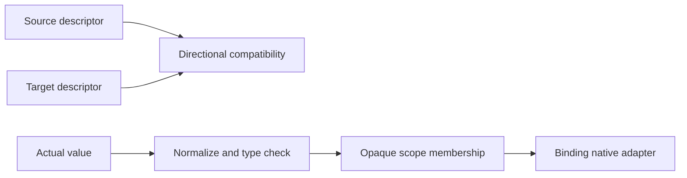

# Types, values and conditions

IR uses a small structural type algebra for port compatibility. JSON Schema checks document structure; it is not the port type system. Static compatibility asks whether every possible source value fits the target, while runtime validation checks the actual published value.

## Type algebra

| Kind | Contract |
| --- | --- |
| `null` | Only null |
| `boolean`, `integer`, `number`, `string` | Scalar; optional `nullable: true`; integer can flow to number |
| `array` | `items` descriptor, optional nullable container |
| `object` | `properties`, unique declared `required` names, `additional` false or a descriptor; defaults closed |
| `json` | All ordinary JSON including null, recursively excludes opaque atoms |
| `opaque` | Exact nominal `id` and `version`, optional nullable capability |

There is no general union, recursive descriptor, coercion or refinement type. `additional: true` is invalid. `json` can accept any JSON-only descriptor but cannot flow into a narrower descriptor without an explicit validating operation.

## Directional compatibility

| Source → target | Result / reason |
| --- | --- |
| Integer → number | Accepted; reverse direction generally rejected |
| Boolean → number | Rejected |
| Nullable → non-nullable | Rejected |
| Object → object | Target required keys must be guaranteed; possible declared/additional keys must fit the target |
| Open object → closed object | Rejected when extra values remain possible |
| Array → array | Element compatibility checked recursively |
| Opaque → opaque | Exact nominal equality required; scope/native ABI checks still remain |
| Constructed object/array → target | Children checked directly, preserving literal precision rather than inventing union types |

[types.rs](../../crates/aixand-ir/src/types.rs) owns compatibility and value checking. [validation.rs](../../crates/aixand-ir/src/validation.rs) checks expression types and path possibilities. An optional property, array index or potentially null/dynamic container produces `runtime_presence` warnings where traversal might fail. Warnings neither establish presence nor narrow `json`.

## Runtime values and identity

[value.rs](../../crates/aixand-ir/src/value.rs) stores strings, arrays and objects in immutable `Arc` values. Cloning an opaque token preserves pointer identity, not a new resource. The token contains nominal identity only; payloads and cleanup live in [Scope](../lifecycles/scopes.md). A fabricated token can pass nominal type comparison and still fail scope validation.

## 0.2 operators

| Operator | Accepted operands | Behavior |
| --- | --- | --- |
| `eq`, `ne` | Matching boolean/string/numeric scalar families; null with scalar or null; nullable equality allowed | Exact string equality, no coercion; integers and numbers share numeric family |
| `lt`, `le`, `gt`, `ge` | Two non-null numeric operands | Numeric ordering only |
| `and`, `or` | At least two boolean operands | Left-to-right short circuit, boolean result |
| `not` | One boolean operand | Negation |

Arrays, objects, opaque values and untyped `json` cannot be compared. Every operand is statically checked even if short-circuited at runtime. Conditions do not refine types. [conditions.rs](../../crates/aixand-ir/src/conditions.rs) shares these rules between validation and pure evaluation. [Core branching tests](../../crates/aixand-ir/tests/branching.rs) cover comparison families, short circuit and lexical access; [core conformance](../../crates/aixand-ir/tests/conformance.rs) covers object/array/nullability and nominal compatibility.
