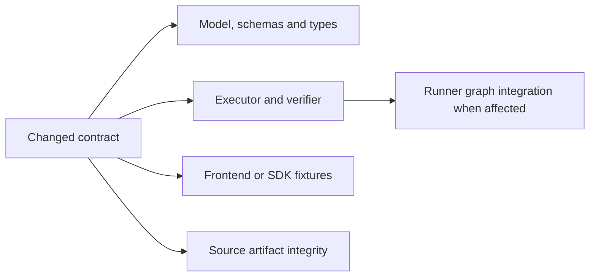

# Develop and verify Workflow IR

Choose checks by the owning contract. Core tests exercise portable semantics without Python or providers; frontend and SDK checks require their own environments. Source artifacts support isolated qualification without modifying the Suite checkout.



## Source and test map

| Change | Implementation | Focused evidence |
| --- | --- | --- |
| Records/JSON/schemas | [model](../crates/aixand-ir/src/model.rs), [JSON](../crates/aixand-ir/src/json.rs), [schema](../crates/aixand-ir/src/schema.rs) | [Core conformance](../crates/aixand-ir/tests/conformance.rs), [invalid expectations](../examples/invalid/expected.json) |
| Types/references/conditions | [types](../crates/aixand-ir/src/types.rs), [validation](../crates/aixand-ir/src/validation.rs), [conditions](../crates/aixand-ir/src/conditions.rs) | [Core branching](../crates/aixand-ir/tests/branching.rs) |
| Preparation/publication/cleanup | [executor](../crates/aixand-ir-runner/src/runner.rs), [scope](../crates/aixand-ir-runner/src/scope.rs) | [Conformance](../crates/aixand-ir-runner/tests/conformance.rs), [preflight](../crates/aixand-ir-runner/tests/preflight.rs), [branching](../crates/aixand-ir-runner/tests/branching.rs) |
| Host graph admission | [GraphControl](../crates/aixand-ir-runner/src/control.rs), executor graph APIs | [Separate Runner graph tests](../../runner/tests/graph.rs) |
| Verifier package | [Native binding](../crates/aixand-ir-verifier/src/lib.rs), [catalog](../crates/aixand-ir/catalogs/verifier.json) | [Execution test](../crates/aixand-ir-verifier/tests/execution.rs) |
| SDK adaptation | [Adapter](../crates/aixand-ir-aixand/src/lib.rs), [loop](../crates/aixand-ir-aixand/src/python.rs), [interpreter](../crates/aixand-ir-aixand/src/host.rs) | [SDK fixtures](../crates/aixand-ir-aixand/tests/sdk.rs), [embedded](../crates/aixand-ir-aixand/tests/embedded.rs), [fake workflow](../crates/aixand-ir-aixand/tests/real_workflow.rs) |
| Python compilation | [Lowerer](../crates/aixand-ir-frontend/src/lib.rs), [mapping](../crates/aixand-ir-frontend/src/mapping.rs) | [Compiler](../crates/aixand-ir-frontend/tests/compiler.rs), [lowering](../crates/aixand-ir-frontend/tests/lowering.rs), [branching](../crates/aixand-ir-frontend/tests/branching.rs) |
| Distribution | [package.py](../scripts/package.py) | [test_package.py](../scripts/test_package.py) |

## Commands and environments

Use Rust 1.95+ from `workflow/ir`. These retained commands exercise local data-only behavior:

```sh
cargo run -p aixand-ir-cli -- validate examples/research-explicit.json
cargo run -p aixand-ir-cli -- run examples/verifier.json --inputs examples/verifier-inputs.json
cargo run -p aixand-ir-cli -- canonicalize examples/verifier.json
cargo run -p aixand-ir-cli -- schema workflow
cargo run -p aixand-ir-cli -- schema workflow --ir-version 0.2
cargo run -p aixand-ir-cli -- catalog aixand
cargo test -p aixand-ir -p aixand-ir-runner -p aixand-ir-verifier
cargo fmt --all --check
```

`validate --structural` omits catalog semantics. Normal validate/run compose both bundled catalogs plus each `--catalog FILE`; exact duplicates reject. Extra catalogs install no executable bindings. `lower-python --catalog FILE` instead uses only supplied catalogs when that option is present; without it the bundled catalogs are selected. Canonicalize processes portable JSON, not semantic workflow normalization.

The [CLI manifest](../crates/aixand-ir-cli/Cargo.toml) gates optional `frontend` and `sdk` features. Preserve the [SDK setup commands](integrations/sdk.md#sdk-environment-and-first-run) and [compiler subset](../examples/python/README.md) when preparing those environments:

```sh
cargo run -p aixand-ir-cli --features frontend -- lower-python examples/research.py
cargo clippy --workspace --all-targets --all-features -- -D warnings
AIXAND_IR_SDK_SITE_PACKAGES="$PWD/.venv/lib/python3.14/site-packages" cargo test --workspace --all-features
```

SDK tests fail when their required fixture environment is missing; they do not silently qualify untested integration. These commands are developer instructions, not a claim that this documentation task ran them.

## Distribution and reference maintenance

[Distribution](distribution.md) retains exact packaging/verification commands, independent offline checking and combined Runner artifacts. Packaging rejects symlinks and existing output directories, records per-file SHA-256 plus archive checksum, and produces deterministic archives for identical bytes/modes/versions. Integrity verification does not itself compile; `verify --check` additionally runs offline tests using a prepopulated toolchain/cache. Individual crates.io publication is a separate action.

Maintain [v0.1 specification](specification.md) and [v0.2 extension](branching-v0.2.md) as exact references. [Conformance](conformance.md) and [branching implementation](branching-implementation.md) provide detailed test inventories, with historical limits called out in [implementation status](architecture/composition.md#implementation-status). Preserve reference heading anchors and existing inbound links when adding focused pages.

The component publication manifest is [publication.json](publication.json). Paths are relative to this docs directory and routes remain in `ir`; `ir/development` and `ir/validation` are stable entrypoints. No UI screenshots are needed for this contract/runtime component.

## Two-turn frontend fixture

From `workflow/ir`, compile without executing Python source:

```sh
cargo run -p aixand-ir-cli --features frontend -- lower-python examples/python/managed_codex_two_turns.py --catalog examples/real-agent/catalog.json
```

See the [fixture guide](../examples/python/README.md) for exact mapping, omission, diagnostics, generated-file comparison and the separate live-host command.
