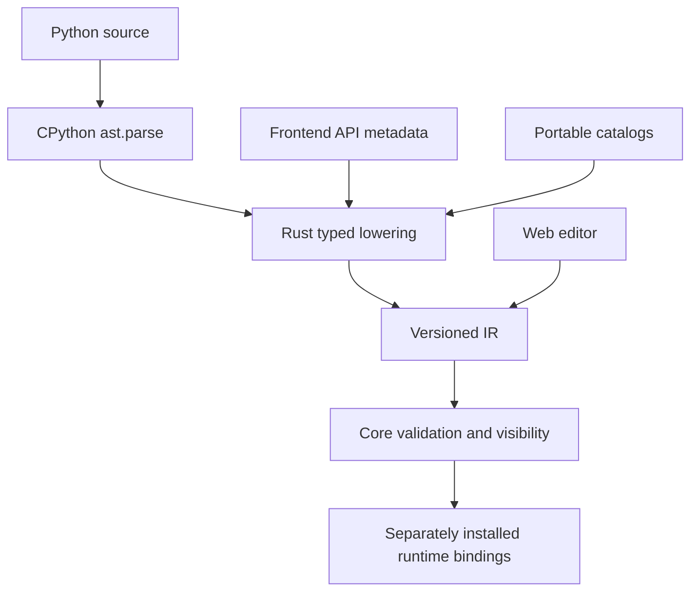

# Restricted Python compilation and authoring clients

The optional frontend compiles a restricted Python AST into the same portable IR consumed by Rust hosts and Web. It parses through CPython but never executes workflow source, decorators, imports, annotations or function bodies. Frontend mappings describe API spelling; they are separate from catalogs and executable bindings.

## Supported subset

| Surface | Current implementation |
| --- | --- |
| Module | Optional unaliased `import aixand`, exactly one async function with `@aixand.workflow` without arguments |
| Parameters | Ordinary named, annotated; literal-data defaults only; no variadics or specialized forms |
| Annotations | `str`, `int`, `float`, `bool`, `None`, `list[T]`, `dict[str, T]`, `T | None`, `aixand.Json` |
| Statements | Simple assignment, awaited registered operation, `pass`, structured if/elif/else, final top-level return |
| Values | Safe literals, literal-key dictionaries, lists, bound symbols and explicitly mapped result properties |
| Calls | Statically registered function spelling or mapped method on a typed bound receiver; receiver cannot be overridden |
| Conditions | Scalar comparisons, strict booleans, and/or/not; no constant folding |
| Returns | Unannotated literal-key dict names output ports; annotated or other value returns one `result`; no early/nested returns |
| Version | Ordinary sequential sources emit 0.1; branches or boolean/comparison expressions upgrade to 0.2 |

Arbitrary calls/attributes, arithmetic, truthiness, chained comparisons, `is`/`in`, loops, comprehensions, mutation, exceptions and cleanup scopes are rejected with source spans. Literal source integers must remain portable. Names assigned in either branch arm become unavailable afterward, including rebound outer names; a fresh assignment is required before reuse. No implicit merge exists.

## Mapping contract

| Metadata | Meaning / validation |
| --- | --- |
| `python`, `operation` | Recognized API spelling and exact contract identity |
| `keyword_operations` | A supplied named keyword can select an exact newer contract; omission retains original contract |
| `receiver` | Required nominal opaque port; method resolution uses receiver type |
| `positional` | Ordered catalog ports; remaining ports are keyword-only |
| `result` | Assignable primary output, if present |
| `properties` | Output/path projections through guaranteed non-null required object fields; never opaque introspection |

[Mapping implementation](../../crates/aixand-ir-frontend/src/mapping.rs) rejects duplicate spelling/receiver entries and validates metadata against selected catalog definitions when used. [Bundled mappings](../../crates/aixand-ir-frontend/mappings/aixand.json) are compiler data, not SDK decorators or executable dispatch.

[Lowerer](../../crates/aixand-ir-frontend/src/lib.rs) maintains typed symbols, deterministic invocation counters and an IR-pointer-to-source map. It delegates semantic checks to core as it emits steps. [Diagnostics](../../crates/aixand-ir-frontend/src/diagnostic.rs) relocate validation errors to the longest matching source-map prefix, retaining IR location and invocation identity. Columns account for CPython UTF-8 offsets.

## Web and bridge boundary

Web edits the Workflow record directly; it does not own a second execution model. [SequenceEditor](../../../../apps/web/src/workflows/SequenceEditor.tsx) handles nested arms, while the [Server workflow bridge](../../../../apps/server/workflow-bridge/src/main.rs) exposes Rust validation and visibility. `visible_operations(workflow, sequence_path, before)` prevents arm-local producers from leaking into picker choices. Editor state and reference filters are not serialized workflow semantics.

The exact subset guide stays at [Python examples](../../examples/python/README.md). Use [compiler tests](../../crates/aixand-ir-frontend/tests/compiler.rs), [lowering tests](../../crates/aixand-ir-frontend/tests/lowering.rs), [branching tests](../../crates/aixand-ir-frontend/tests/branching.rs) and the [three-way branching fixture](../../examples/branching/README.md). Frontend test success does not establish SDK availability; binding/runtime preparation is a later boundary.
