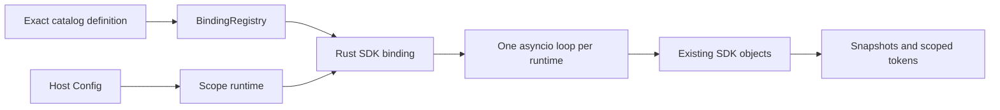

# Catalogs, bindings and SDK integration

Portable catalogs describe contracts. BindingRegistry separately maps the full immutable definition to an executable implementation. The SDK adapter installs only definitions it already supports and retains existing SDK objects; it does not recreate Agent Manager, Carrier or Undercurrent behavior.



## Registration and installation

| Boundary | Contract |
| --- | --- |
| `CatalogRegistry::add` | Stages and rejects exact identity conflicts transactionally; does not load code |
| `BindingRegistry::register` | Rejects duplicate binding identity |
| Binding resolution | Compares entire `OperationDefinition`, including descriptive fields, not just ID/version |
| `install_catalog` | Rejects unsupported or altered definitions before Python imports/runtime construction; selected catalog is a subset, not code discovery |
| `install_connection_catalog` | Accepts an existing not-yet-used SDK connection; adapter owns its loop and scope cleanup |
| Adapter registration | Registers cleanup before registry mutation, stages registry changes using a clone |
| Native verifier | Independent `verifier.verify@1.0.0` implementation uses public binding API; no Python or service calls |

[Registry](../../crates/aixand-ir-runner/src/registry.rs), [catalog registry](../../crates/aixand-ir/src/catalog.rs), [adapter](../../crates/aixand-ir-aixand/src/lib.rs), [verifier](../../crates/aixand-ir-verifier/src/lib.rs).

## Operation families and completion

The exact version/port inventory lives in the [Aixand catalog](../../crates/aixand-ir/catalogs/aixand.json), not a duplicate table of SDK signatures here. Versions of the same operation can differ; never rewrite a selected version to the newest one silently.

| Family | Returned facts / capabilities | Boundary to preserve |
| --- | --- | --- |
| Agent spawn/get | Scoped `aixand.agent`, public run ID and nullable address | Spawn ownership differs from attachment; launch/readiness is not an application answer |
| Send/wait | Opaque `aixand.input_receipt`, selected session observation | Omitted `after`, explicit null and explicit receipt stay distinct; SDK checks revision/session affinity |
| Inspect/read-screen/stop | Selected observation, explicitly UTF-8 decoded text, or empty output | Screen decoding replaces invalid UTF-8; stop is explicit effect |
| Mailbox and message send/reply | Scoped mailbox/message plus selected snapshots | Carrier delivery does not retarget the latest direct-send boundary |
| Mailbox wait | Status, next cursor, arrays of message atoms and snapshots | Timeout is ordinary result data |
| Correlated reply wait | Message and snapshot; optional sender postcondition | Timeout is failure; sender mismatch fails and leaves reply unacknowledged |
| Message ack/inspect/decode | Acknowledgment, fresh snapshot, or explicitly parsed JSON | No automatic application ack; old published snapshots stay immutable |
| Host application run | JSON `result` from allowlisted async entrypoint | Host installs code; portable input selects a name, never an arbitrary module |
| Native verifier | `passed`, `summary`, `issues` under `result` | Failed content verification is successful invocation data, not executor failure |

## Host configuration and applications

`Config` owns `python_paths`, connection options, address-to-credential-file maps, optional `python_interpreter` and application allowlist. None belongs in catalogs or portable workflow records. `with_context` accepts only string-map `labels` and `metadata`; spawn/application dispatch adds `workflow.step_id` through the existing SDK context API.

Applications map a host name to `module:function`; installation checks that entrypoints are async functions. The coroutine receives keyword arguments `connection` and JSON `arguments`. Missing allowlist names fail with `application_not_installed`. Return values are encoded with nonfinite JSON disabled and parsed through IR's strict JSON boundary. This is trusted host executable configuration. Version application names for incompatible behavior; see [application configuration and cleanup](#application-configuration-and-cleanup).

The optional session observer receives invocation, provider, run ID and Undercurrent session ID after successful spawn/get. It carries public attachment identity, not credentials or native handles. Observer callbacks are host code; review their failure behavior separately from binding contracts.

## Python runtime and errors

[host.rs](../../crates/aixand-ir-aixand/src/host.rs) initializes one process-wide CPython interpreter. Explicit settings must use absolute executable/home/prefix paths matching the linked library and expected `sys` identities. Call initialization before unrelated Python users; scopes cannot switch interpreter homes. The configured isolated initialization disables bytecode writes and signal handlers.

[python.rs](../../crates/aixand-ir-aixand/src/python.rs) owns asyncio task dispatch, cancellation callbacks and loop shutdown. SDK calls are wrapped with `connection.wait_for` so managed consumer failures interrupt pending work. Error adaptation preserves available run/session/delivery identities, cause and effect-certainty details. It does not translate transport uncertainty into proof of no effect.

[SDK fixture tests](../../crates/aixand-ir-aixand/tests/sdk.rs) use real SDK classes over controlled transport boundaries. [Embedded tests](../../crates/aixand-ir-aixand/tests/embedded.rs) exercise interpreter identity and actual Python module launching in isolated children. [Real workflow tests](../../crates/aixand-ir-aixand/tests/real_workflow.rs) use deterministic fake bindings. Historical [live example evidence](../../examples/real-agent/evidence/run.json) is retained; this documentation task did not repeat live execution.

## SDK environment and first run

From `workflow/ir` in the Suite checkout:

Install the sibling SDKs into a local environment:

```sh
uv venv --python 3.14 .venv
uv pip install --python .venv/bin/python -e ../../../aixand-libraries/filesystem -e ../../../aixand-libraries/local-runtime -e ../../../manager-suites/agent-manager -e ../../../carrier -e ../../../undercurrent/python -e ../../sdks/python
```

Create a runtime configuration file, outside the workflow:

```json
{
  "python_paths": [".venv/lib/python3.14/site-packages"],
  "connection": {
    "timeout": 300,
    "stable_for": 2,
    "state_dir": ".aixand-runs",
    "carrier": {"mode": "private"}
  }
}
```

Use the actual site-packages path for your Python version. `connection` accepts SDK connection options; `mailbox_credentials`, `agent_credentials` and `receipt_credentials` are optional address-to-credential-file maps. Runtime configuration can contain service configuration and credentials; portable workflows and catalogs cannot.

```sh
cargo run -p aixand-ir-cli --features sdk -- run examples/research-implicit.json --inputs task-inputs.json --sdk-config runtime.json
```

`task-inputs.json` supplies `{"task":"..."}`. This command launches real agents using the configured SDK environment. Cleanup detaches by default. `--stop-owned` stops only agents spawned by that scope; explicitly invoking `aixand.agent.stop` can stop an attached agent. The supplied connection's `stop_on_exit` setting is overridden by the explicit Rust scope policy.

`examples/team.json` models the finite coordinator request/reply flow. It checks the authenticated reply sender, explicitly acknowledges the answer, and returns its content. `examples/research-explicit.json` returns a run ID after two explicit receipt waits. `examples/research-implicit.json` faithfully preserves omitted waits and returns no application result.

## Application configuration and cleanup

```json
{"applications": {"pathspec.cell.plan.v1": "pathspec_cli.cell_supervisor:run"}}
```

Cancellation is forwarded to the coroutine and joined before scope cleanup. The application
must preserve uncertain effects and register spawned agents with its supplied connection.
Normal scope cleanup still distinguishes owned agents from attached agents. Applications should
explicitly stop attached agents only when their own workflow authorizes it.
