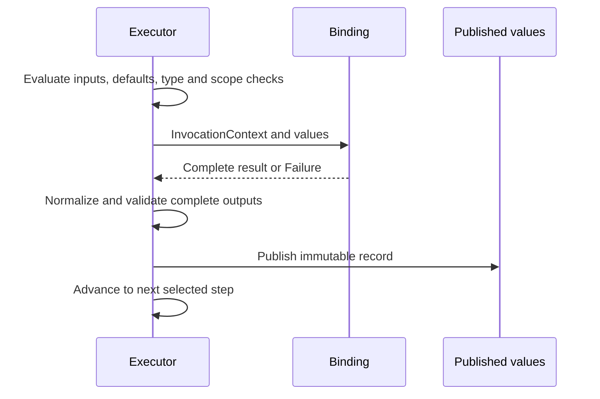

# Execution, branching and host graphs

Normal workflow execution is a recursive sequential interpreter. Each operation awaits its binding-defined completion, validates the entire output record, then publishes it atomically. Unused results do not remove producing effects. Failure prevents later operations and final output evaluation.



## Observable transitions

| Observation | Meaning | Does not establish |
| --- | --- | --- |
| `Prepared` with warnings | Runtime preparation passed | Any binding invocation happened |
| `Started` | Arguments evaluated and checked; dispatch begins | External effect completed |
| `Published` | Complete checked output record entered the environment | Durable checkpoint or exactly-once external effect |
| `BranchEvaluated` | One condition evaluation succeeded, boolean result and selected arm known | Unselected-arm invocations occurred |
| `Failed` | Contextual execution failure emitted on instrumented step paths | Every possible preparation/output/host failure emits this event |
| `Completed` | Final outputs evaluated and checked | Owning-scope cleanup succeeded |

Observers are synchronous host callbacks, not a retained event store. The returned result/failure remains authoritative, including failures outside step-event emission. [runner.rs](../../crates/aixand-ir-runner/src/runner.rs) defines event placement.

## Branch state and resource lifetime

A branch evaluates its condition once, executes only its selected arm in order, restores the parent's publication environment and continues. A missing else is an empty false arm. Both arms are validated and all bindings resolved during preparation, including literal-false arms.

| Value / ID | Visibility |
| --- | --- |
| Workflow input and pre-branch operation value | Both arms and later enclosing steps |
| Value produced in one arm | Later steps in that arm and its descendants |
| Arm-local value after branch or in sibling arm | Rejected; no merge or branch outputs |
| Branch ID | Globally unique but has no output ports |
| Opaque resource created in selected arm | Remains in workflow Scope even after value environment is restored |

Global uniqueness includes mutually exclusive arms. `visible_operations` exposes the same lexical rules to authoring clients. Read the exact [0.2 contract](../branching-v0.2.md#lexical-values-and-ids), [runner branching tests](../../crates/aixand-ir-runner/tests/branching.rs) and [core branching tests](../../crates/aixand-ir/tests/branching.rs).

## Host graph APIs

The executor also exposes flat graph execution for a host such as durable Runner. Dependencies are separate Rust API arguments, not workflow document fields. This API does not change the sequential semantics of ordinary `run`/`run_json`.

| API / state | Current behavior | Host responsibility |
| --- | --- | --- |
| `validate_graph` | Flat operations only; dependencies cover every operation, name distinct earlier parents, and cover every step-reference via ancestry | Supply graph dependency map in document order |
| `run_graph_json` | Prepares JSON interfaces; schedules ready independent operations concurrently; validates restored records; callback receives JSON-serializable publications | Own scope, persistence, trustworthy restored state and failure/recovery policy |
| Opaque graph outputs | Remain in live scope; cannot be persisted as JSON | Do not treat a missing JSON callback as a serializable checkpoint |
| `GraphRevision` | Workflow, dependency map, revision, held flag, previously claimed IDs | Keep admitted active work consistent with revisions |
| `run_graph_controlled` | Polls control, claims before admission, keeps active invocation state, publishes and seals through host callbacks | Implement admission/revision/storage authority |
| Held revision | Previously claimed work may reconcile; new admission remains held | Distinguish reconciliation from new effects |
| Controlled operation failure | Calls `fail` except for `effect_uncertain` and `binding_panic`, then cancels child token | Preserve uncertainty and inspect original identities |

[GraphControl](../../crates/aixand-ir-runner/src/control.rs) has no storage dependency. Graph methods borrow a caller-owned scope and do not provide the owned JSON wrapper's detached cleanup supervisor. Review host cancellation and recovery separately; portable tests do not prove durable graph safety. Integration evidence is in [Runner graph tests](../../../runner/tests/graph.rs), with the [Runner source entry](../../../runner/src/lib.rs) as the boundary to follow.

Normal invocation failure, partial-output rejection, panic context and uncertain-effect retention are covered by [executor conformance tests](../../crates/aixand-ir-runner/tests/conformance.rs). There is no automatic retry or rollback in the interpreter.

## Rust embedding

```rust
use aixand_ir::{parse_catalog, parse_workflow, CatalogRegistry, VERIFIER_CATALOG};
use aixand_ir_runner::{BindingRegistry, CleanupPolicy, Runner};
use tokio_util::sync::CancellationToken;

#[tokio::main]
async fn main() -> Result<(), Box<dyn std::error::Error>> {
let workflow = parse_workflow(&std::fs::read_to_string("examples/verifier.json")?)?;
let catalogs = CatalogRegistry::new([parse_catalog(VERIFIER_CATALOG)?])?;
let mut bindings = BindingRegistry::default();
aixand_ir_verifier::register(&mut bindings)?;
let result = Runner::new(catalogs, bindings).run_json(
    &workflow,
    serde_json::json!({"title":"Architecture", "body":"A workflow invokes operations."}),
    CleanupPolicy::Detach,
    CancellationToken::new(),
).await?;
assert_eq!(result["result"]["passed"], true);
Ok(())
}
```

For opaque inputs/results, create a `Scope`, register bindings and call `Runner::run`. Keep that scope live while using returned capabilities and call `scope.close().await` when finished. `Scope::insert` stores native values separately from identity tokens; `Scope::get` checks registration and adapter compatibility. A cloned token preserves identity. Creating an `Opaque` token by hand does not make it valid.

`run_json` owns its scope; `run_scoped_json` consumes a scope configured by the caller. Both require JSON-only workflow interfaces, close the scope on every ordinary outcome, and supervise cleanup when the calling future is dropped. Cancellation is cooperative and never promises rollback or exactly-once effects. Bindings must implement cancellable I/O; a blocking implementation cannot be forcibly interrupted safely.
