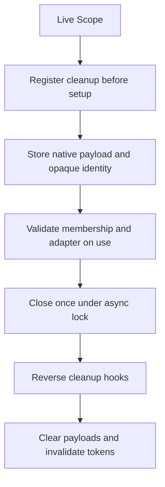

# Scope ownership, cancellation and failures

A Scope holds runtime payloads, cleanup hooks and a background-failure signal. Immutable opaque tokens identify entries; copying or dropping tokens neither acquires ownership nor closes resources. Cleanup policy is chosen by the host, outside the workflow document.

## Entry-point ownership

| API | Scope ownership | Interface / cleanup contract |
| --- | --- | --- |
| `run` | Caller lends and retains Scope | Embedded values may contain opaque atoms; caller closes after using results |
| `run_json` | Executor creates Scope | JSON-only interface; delegates to owned wrapper |
| `run_scoped_json` | Consumes configured Scope | Closes after preparation failure, execution failure or success; detached Tokio task supervises cleanup when caller future drops |
| `preflight_json`, `preflight_template` | Caller retains Scope | No invocation; no ownership transfer or implicit close |
| Graph methods | Borrow caller's Scope | Host owns scope lifecycle and recovery coordination |

`Scope::insert` stores `Arc<dyn Any + Send + Sync>` separately from the atom. `Scope::get<T>` checks live membership and downcasts to the accepted native representation. Nominal type equality is necessary but insufficient. `validate_value` recursively checks nested tokens. After close, existing tokens are unusable.

## Cleanup and failure state

| State or policy | Behavior |
| --- | --- |
| `Detach` | Default; adapter closes orchestration without stopping owned agents |
| `StopOwned` | Adapter asks SDK connection cleanup to stop agents owned by that connection, not merely attached handles |
| Explicit stop operation | May stop an attached agent when workflow explicitly calls it |
| `report_failure` | Records first background failure and signals pending work |
| `close` | Marks closed, signals failure token, invokes hooks in reverse order, clears payloads; repeated close returns success |
| Cleanup error or panic | Aggregated; panic becomes `cleanup_panic`; primary execution failure retained with cleanup errors |
| Cleanup fails after body success | Owned JSON wrapper returns cleanup failure despite earlier `Completed` observation |

[scope.rs](../../crates/aixand-ir-runner/src/scope.rs) implements membership, close locking and reverse cleanup. [Failure](../../crates/aixand-ir-runner/src/error.rs) carries code, message, optional structured details and invocation/operation context. Binding failures may retain run/session/delivery IDs and effect certainty.

## Cancellation boundary

The executor selects between cancellation, scope failure and binding completion. Cancellation drops the binding future; adapters must implement cancellable I/O and resource cleanup. Blocking code cannot be safely forced to stop. The SDK adapter forwards cancellation to asyncio and closes through the SDK before stopping its loop. The owned JSON wrapper's task and cancellation-on-drop guard make resource cleanup independent of the caller continuing to poll.

Cancellation and timeouts do not roll back external effects or establish that a launch/send did not occur. Preserve original IDs and uncertainty details; the interpreter does not replay failed mutations. Logical one-invocation-per-step is not an exactly-once external guarantee.

Read [executor conformance tests](../../crates/aixand-ir-runner/tests/conformance.rs) for fabricated/foreign/expired tokens, dropped callers, background failures, preparation cleanup and panic handling. [SDK tests](../../crates/aixand-ir-aixand/tests/sdk.rs) cover owned versus attached resources, partial setup and pending-I/O cancellation; [SDK boundary](../integrations/sdk.md) explains what those fixtures establish.
