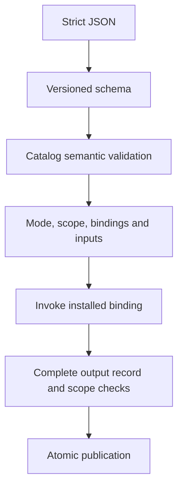

# Validation and preparation boundaries

Validation establishes progressively stronger facts. Parsing a schema-valid workflow does not resolve operations, supply runtime inputs or install bindings. Preparation resolves every operation in both branch arms before any invocation effects.

## Gate contracts

| Gate | Requires | Checks / evidence |
| --- | --- | --- |
| Strict parse | JSON text | Duplicate keys, Unicode and portable numbers: [json.rs](../crates/aixand-ir/src/json.rs) |
| Structure | Document and embedded schemas | Supported version, closed records, tagged variants, identifiers: [schema.rs](../crates/aixand-ir/src/schema.rs) |
| Catalog admission | Selected catalogs | Definition validity, defaults, exact identity uniqueness; `add` stages definitions transactionally: [catalog.rs](../crates/aixand-ir/src/catalog.rs) |
| Semantic workflow | Catalog registry | Defaults, port types, global IDs, exact operations, lexical references, output promises: [validation.rs](../crates/aixand-ir/src/validation.rs) |
| Runtime preparation | Bindings, scope, supplied inputs, execution mode | Whole definition equality, all arms resolved, JSON-only interface gate, unknown/missing inputs, native normalization and live opaque membership: [runner.rs](../crates/aixand-ir-runner/src/runner.rs) |
| Invocation | Evaluated expressions and resolved binding | Runtime presence, defaults, types; normalized complete outputs and scope membership before publication |

`preflight_json` uses the same preparation path without invoking bindings. `preflight_template` validates contracts, scope, JSON-only interfaces and bindings before continuation inputs exist; it cannot validate those future values. Both leave resource ownership with the caller.

## Diagnostic contracts

| Surface | Fields / interpretation |
| --- | --- |
| Core `Diagnostic` | `code`, `message`, JSON Pointer `location`, `severity`, optional `invocation_id` and `operation` |
| Semantic success | Returns warnings; absence of errors does not establish runtime presence |
| `ValidationError` | Collection of diagnostics; many semantic paths return the first encountered failure rather than all possible errors |
| Executor `Failure` | `code`, `message`, optional JSON `details`, invocation/operation context, retained `cleanup_errors` |
| Frontend compiler diagnostics | Source file and span plus relocated IR pointer/context when available |

Pointers escape `~` and `/` in path segments. Branch-condition errors carry branch invocation context without an operation identity; inner operation failures retain their own context.

| Code / family | Likely boundary | Next inspection |
| --- | --- | --- |
| `json`, `number`, `schema` | Portable parse/structure | Raw source and selected version |
| `duplicate_operation`, `duplicate_invocation` | Catalog or ID registration | Exact identities across all selected definitions/arms |
| `forward_reference`, `out_of_scope`, `branch_output` | Lexical references | Producer position and enclosing sequence |
| `comparison_type`, `condition_type`, `type` | Type checking | Published descriptor; truthiness is unsupported |
| `runtime_presence` | Path warning or evaluation error | Actual container/key/index; warning is not a guarantee |
| `missing_binding`, `incompatible_binding`, `binding_conflict` | Host binding preparation | Registered full definition and implementation |
| `opaque_boundary`, `opaque_scope`, `opaque_adapter` | Mode/lifetime/native representation | Interface type, accepted live scope and adapter |

[Diagnostic model](../crates/aixand-ir/src/diagnostic.rs), [failure model](../crates/aixand-ir-runner/src/error.rs), [invalid fixture expectations](../examples/invalid/expected.json), [preflight tests](../crates/aixand-ir-runner/tests/preflight.rs) and [core conformance tests](../crates/aixand-ir/tests/conformance.rs) are the focused reading path. The [CLI](../crates/aixand-ir-cli/src/main.rs) exposes structural-only validation via `validate --structural` and catalog validation via `validate --operation-catalog FILE`.
