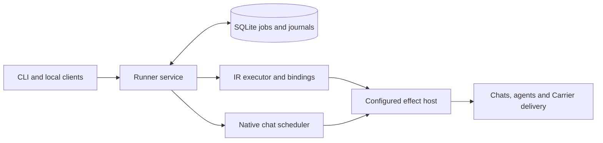

# Runner architecture

Runner is the local Rust authority for accepted workflow jobs, dependency admission, durable execution observations and retained results. Clients can disconnect without owning the execution lifetime. Runner delegates portable operation execution to IR and external chat effects to a host selected by the service operator.

## Reading paths

| Need | Read |
| --- | --- |
| Understand process and authority | [Runtime](architecture/runtime.md), [storage](architecture/storage.md) |
| Change admission or a client contract | [IPC and admission](architecture/ipc.md), [protocol reference](reference/protocol.md) |
| Change execution | [DAG scheduling](lifecycles/scheduling.md), [plans and continuations](lifecycles/plans.md) |
| Diagnose interrupted work | [Outcomes and recovery](lifecycles/recovery.md) |
| Integrate another execution host | [Effect hosts](integrations/effect-hosts.md), [IR and SDK boundaries](integrations/ir-sdk.md) |
| Verify or ship a change | [Development](development/verification.md), [installation ownership](development/installation-ownership.md), [existing installation reference](installation.md) |
| Check current limits | [Implementation status](reference/status.md) |

Start with runtime, then the affected lifecycle and its tests. A successful submit establishes acceptance; a completed workflow establishes execution and cleanup, not satisfaction of the caller's business requirement. For example, verifier output may contain `passed: false` in a completed job.

The [component README](../README.md) retains CLI examples and existing anchors. This documentation describes current source behavior, including native reconciliation and mutable plans that need more precise treatment than a single generic restart rule.
