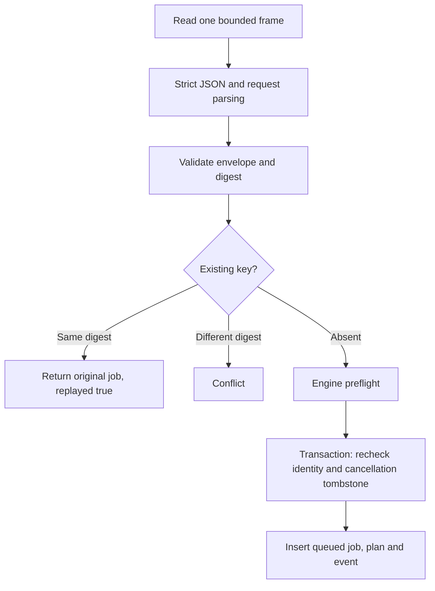

# IPC admission and submission identity

Admission validates a request before retaining new work. The submission key is scoped to the service home and identifies the canonical digest of the entire submission, including inputs and metadata. Repeating identical content recovers the original job even after runtime configuration changes.

## Admission contracts

| Input or stage | Enforced contract |
| --- | --- |
| Framing | UTF-8 newline-terminated JSON; one request and response per connection; request read timeout five seconds |
| JSON | IR parser rejects duplicate keys; request and submission reject unknown fields |
| Key | Nonblank text, at most 256 bytes |
| Envelope | `inputs` and `metadata` are objects; defaults are empty objects |
| New workflow | Engine validates format, inputs, bindings and graph dependencies; chat effects also require host validation |
| Commit race | Store checks the key again inside the transaction; concurrent identical submissions share a job |
| Late cancellation | `cancel_key` retains a tombstone even without a known job, blocking a later commit for that key |
| Lost response | Use `lookup` or resubmit identical content under the same key; never infer rejection from a timeout |

Preflight runs outside the insertion transaction and can contact the configured effect host. Passing preflight does not mean the job has been committed or executed. Cancellation by key serializes with submission commit even while preflight awaits a host.

## Local security boundary

| Platform | Admission to the byte stream |
| --- | --- |
| Unix | Unix-domain socket at `HOME/runner.sock`; newly created home mode 0700, socket/database mode 0600; filesystem access supplies the boundary |
| Windows | Private directory and protected endpoint descriptor via Undercurrent's Windows platform helper; loopback TCP with a 64-character capability token handshake before request dispatch |

On Windows `runner.sock` is a descriptor, not a Unix socket. Descriptor schema is `aixand.local/1`; clients reject descriptors over 4096 bytes or invalid port/token fields. The listener bounds authentication to five seconds and 256 bytes. Existing Unix home permissions are not automatically repaired by the directory-creation branch.

No public network API, multi-tenant authorization layer or provider approval flow is implemented in this admission path. Do not treat access to a home as reduced provider authority.

[Service admission](../../src/service.rs), [request models and digest](../../src/model.rs), [platform transport](../../src/transport.rs), [Rust client timeout](../../src/client.rs), [race and strict parsing tests](../../tests/jobs.rs). Continue with the [wire reference](../reference/protocol.md).
