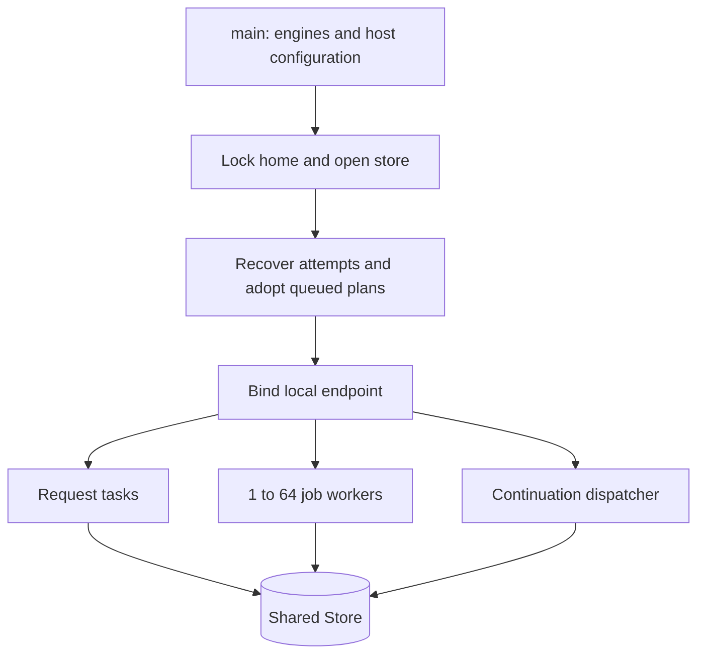

# Rust daemon and execution ownership

The `runner` binary constructs an `IrEngine`, wraps it in `WorkflowEngine`, opens a single state home and serves local requests. The `job_runner` library exposes the same service for trusted embedders. A worker is a Tokio task claiming whole jobs, not a separate provider process.

## Authority map

| Owner | Owns | Does not establish |
| --- | --- | --- |
| `Service` | Exclusive home lock, requests, worker pool, live cancellation tokens, shutdown | Provider isolation between jobs |
| `Store` plus plan methods | Submission identity, claims, events, checkpoints, plan revisions, child registration | Remote effect termination |
| `WorkflowEngine` | Native chat DAG/checkpoint loop and native format routing | Chat implementation or account selection |
| `IrEngine` and IR Runner | Binding resolution, typed values, graph execution and scope cleanup | A generic durable checkpoint of opaque resources |
| Effect host | Idempotent chat acceptance, inspect/cancel, result acknowledgment and delivery | Runner job admission |
| Installer | Immutable payloads, command activation and receipt ownership | Starting the daemon or choosing its state home |

## Concurrency and shutdown

One worker is the default; `serve --workers N` accepts 1–64. SQLite claims eligible queued jobs by ascending submission sequence. Held unstarted jobs and pending adoptions are excluded. FIFO claims do not imply FIFO completions. Dependencies within one job can execute concurrently independently of this job limit.

`serve` rejects reuse of the same service instance. It removes a stale Unix socket only if it is a socket, refusing to replace a regular file. Worker failure cancels the pool; all workers are joined. Shutdown closes the listener, signals execution cancellation and gives an active execution up to ten seconds to return. Resumable suspension differs from caller cancellation; see [recovery](../lifecycles/recovery.md). In-flight client tasks get up to six seconds to persist and finish replies before being aborted.

## Source and evidence

[Binary composition](../../src/main.rs), [Service](../../src/service.rs), [library exports](../../src/lib.rs), [Engine trait](../../src/engine.rs).
[Job tests](../../tests/jobs.rs) cover bounded pool concurrency, independent cancellation, shutdown and ownership. [Process tests](../../tests/process.rs) exercise a killed real daemon. These local checks do not qualify a provider or installation on another OS.
