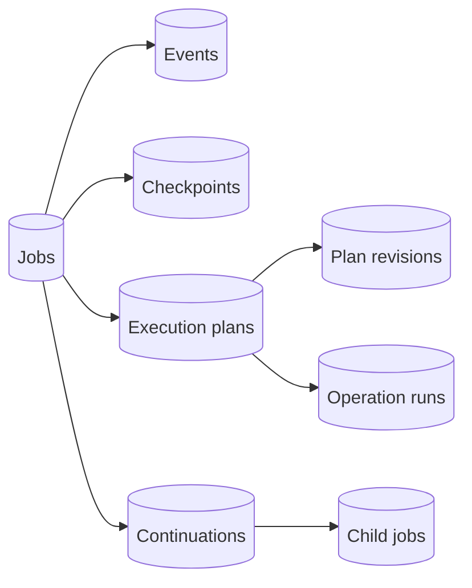

# Durable state and event journal

Runner stores job authority in `jobs.sqlite3` within its explicit home. A mutex serializes one SQLite connection; WAL, `synchronous=FULL`, foreign keys and a five-second busy timeout are configured on open. Transactions pair job transitions with their events, while external effects remain outside the database transaction.

## Storage contracts

| Record | Durable responsibility |
| --- | --- |
| `jobs` | Unique job ID and submission key, sequence, state, original submission/digest, pinned engine, attempt and outcome payload |
| `events` | Global monotonically increasing sequence; job ID, timestamp, kind and JSON data |
| `checkpoints` | Native stage states/acknowledgments/delivery or graph `published` JSON outputs; maximum serialized size 8 MiB |
| `cancelled_submissions` | Persistent key cancellation before or after admission |
| `execution_plans`, `plan_revisions` | Effective versioned workflow, authoring data, phase, held flag and amendment replay identity |
| `operation_runs`, `retired_operations` | Claimed definitions/groups, sealed effect requests, operation status and removed identities |
| `pending_adoptions` | Durable request to suspend and convert a legacy run |
| `continuations` | Parent/key uniqueness, target template, mapping, engine pin, status and child link |

`user_version` greater than 4 is refused with `storage_version`. Fresh creation first creates jobs/events; additive setup ensures the current tables and records version 4. The retained migration test checks survival of version-one jobs and checkpoint creation. It is not a proof of arbitrary future downgrade compatibility.

## Events and failure boundaries

Job `queued`, `running`, `finished`, cancellation and recovery events accompany their transitions. IR observations are wrapped as kind `ir`; their data can describe preparation, invocation start/publication/failure, branch evaluation, chat progress, delivery and SDK session identity. Plan events record claims, amendments, holds and continuation changes.

Event publication is an observation, not a generic effect checkpoint. Native execution persists a `starting` stage before sending `start`; controlled graph execution persists operation claims and sealed requests. JSON publication is retained before downstream scheduling can use it. Opaque values stay in the live scope and cannot be recovered from event text.

If attempt event retention fails, the observer cancels execution, the worker records an uncertain outcome if storage permits and stops the pool. A storage failure can also prevent that final write; inspect persisted records after restoring storage rather than assuming every diagnostic reached disk.

Event pages use `after` as an event sequence, return `next_after`, `has_more`, and the job state observed with the page. The 1–500 row bound also has an approximate 8 MiB data budget; the first event is allowed even if it alone crosses that budget. Drain pages before waiting. Job list cursors use job sequence, not event sequence.

## Data ownership

Inputs and metadata are retained in full, without retention cleanup or automatic secret redaction. Keep runtime credentials in host configuration and use artifact references for large data. Back up a quiesced home with its SQLite WAL files, excluding transient IPC endpoints, or use SQLite backup facilities. Installation receipts are separate from this job database.

[Store and migration tests](../../src/store.rs), [plan persistence](../../src/plans.rs), [worker observer](../../src/service.rs), [pagination tests](../../tests/jobs.rs), [installation reference](../installation.md).
