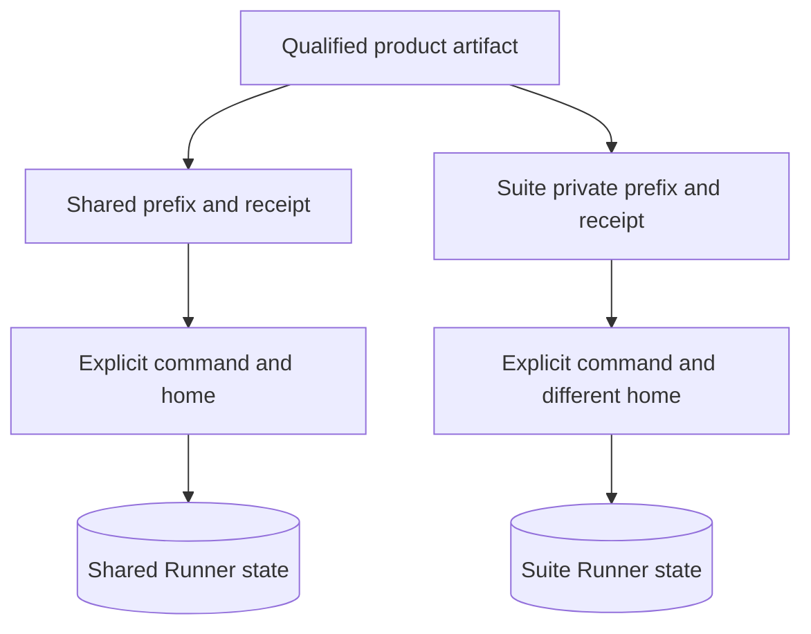

# Installation and activation ownership

Runner packaging and daemon state have separate lifecycles. Installing native software and its Python client activates managed command paths under a receipt; it does not start Runner, register login tasks, add PATH entries or choose a state home. Preserve the detailed commands and release boundaries in [installation.md](../installation.md).

## Ownership contracts

| Boundary | Owner and limitation |
| --- | --- |
| Native payload | Default-feature Rust executable; IR and Windows IPC helper are linked libraries |
| Bundled Python | Pinned CPython 3.12.14 supports installer/client; it is not an embedded service SDK |
| Shared/private scope | Controls prefix ownership and command placement, not storage isolation |
| Service activation | Operator explicitly runs `serve`; installation does not start services |
| Home selection | Explicit `--home`, then `RUNNER_HOME`, XDG state, Windows LOCALAPPDATA, HOME fallback |
| Data migration | Daemon opens the store; consumer does not migrate data or stop active processes |
| Uninstall | Requires `--stopped`; preserves job data |
| Rollback | Generic rollback blocked for this stateful product; compatible software and matching quiesced backup are required |

Use different prefixes and homes for shared and Suite-owned instances. Reinstall replaces software with a new immutable payload without changing job storage. Stop gracefully and back up the full quiesced state, including WAL, before upgrade. An unrelated installed binary is not silently adopted by the schema-two receipt.

## Assembly and evidence

[installation.toml](../../installation.toml) declares native, SDK and resource components, five native targets, pinned runtimes and installed verification commands. [receipt operations](../../scripts/dev/operations.py) enforce stateful rollback and stopped-uninstall boundaries. [build_installers.py](../../scripts/build_installers.py) requires a fresh output path, packages and installs/verifies native and SDK artifacts, builds bootstrap, exercises lifecycle and exports immutable handoffs. It does not publish or deploy them.

The [installed verifier](../../scripts/verify_product.py) starts an actual two-worker service in an explicit temporary home with an unconfigured effect host, verifies pure jobs, replay, lookup, retained events and CLI access. It asserts installed client modules come from the selected environment. The [lifecycle qualifier](../../scripts/qualify_product_installation.py) exercises offline payload use, shared/private isolation, restart persistence, reinstall, corrupt artifact rejection, backups and stopped uninstall. Its marked upgrade fixture proves activation mechanics, not future schema compatibility.

Native OS qualification is per target. Ubuntu 22.04 CI baseline cannot be inferred from a build on a newer local libc. Publication additionally needs reviewed source identities, notices and release checks. Existing hosting URLs and signing/automatic-update plans remain separate release work, as described in the [publication boundary](../installation.md#publication-boundary).
