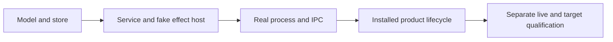

# Develop and verify Runner

Choose checks by the boundary being changed. Pure engine and fake-host tests establish local contracts; they do not establish provider readiness, live delivery, cross-platform packaging or compatibility with an untested future schema.



## Source map and test selection

| Change | Read implementation | Focused evidence |
| --- | --- | --- |
| Admission, keys, queue, cancellation, worker pool | [service.rs](../../src/service.rs), [model.rs](../../src/model.rs), [store.rs](../../src/store.rs) | [jobs.rs](../../tests/jobs.rs) |
| Restart and CLI boundary | [main.rs](../../src/main.rs), [client.rs](../../src/client.rs), [transport.rs](../../src/transport.rs) | [process.rs](../../tests/process.rs), including real crash and live socket client |
| DAG and output restoration | [graph.rs](../../src/graph.rs), [engine.rs](../../src/engine.rs) | [graph.rs tests](../../tests/graph.rs), including overlap/join and missing dependency paths |
| Native host reconciliation | [native.rs](../../src/native.rs), [RPC](../../src/graph.rs) | [workflow_transport.rs](../../tests/workflow_transport.rs), lost start/inspect replies without duplicate workers |
| Amendments, adoption, continuation races | [plans.rs](../../src/plans.rs) | [amendments.rs](../../tests/amendments.rs), plus store unit tests |
| Installation and activation | [installation.toml](../../installation.toml), [builder](../../scripts/build_installers.py) | [verify_product.py](../../scripts/verify_product.py), [lifecycle qualifier](../../scripts/qualify_product_installation.py) |

## Commands and prerequisites

From `workflow/runner`, preserve the documented source commands:

```sh
cargo fmt --all -- --check
cargo test --locked
cargo test --locked --features sdk
cargo clippy --locked --all-targets --all-features -- -D warnings
cargo test --locked --manifest-path ../ir/Cargo.toml -p aixand-ir-runner
```

Rust is pinned to 1.95.0. IR is a sibling path dependency; the Windows platform helper comes from sibling Undercurrent. SDK-feature checks additionally need the matching Python and SDK environment. The supported product helper selects `RUNNER_TEST_PYTHON` and `PYO3_PYTHON` from `tools/.venv` (override with `RUNNER_TEST_ENVIRONMENT`) and supplies Linux libpython lookup:

```sh
./dev.sh develop
./dev.sh check
./dev.sh test
```

On Windows use `.\dev.ps1`. `develop` installs the pinned toolchain and uses uv to create the tooling environment. `check` runs fmt, default-feature clippy, Python lint/format and license checks. `test` runs Rust all-targets and Python client tests; on Linux it also tests the SDK feature. See [product_checks.py](../../scripts/product_checks.py) for exact scope; the broader all-feature clippy command above is a separate retained check.

## Pure development service

This source example uses a Unix shell, Rust 1.95+, and the `../ir` checkout.
The native product also has platform-specific IPC support, including Windows.
The included verifier example needs no Python SDKs, agent, credentials, or
Undercurrent installation. Build from this directory:

```sh
cargo build --locked
./target/debug/runner --home .runner serve
```

In another terminal, from this directory:

```sh
./target/debug/runner --home .runner health
./target/debug/runner --home .runner submit examples/verify.json \
  --inputs examples/inputs.json --key verifier-demo
./target/debug/runner --home .runner list
```

Use the returned job ID:

```sh
./target/debug/runner --home .runner inspect JOB-ID
./target/debug/runner --home .runner events JOB-ID --follow
./target/debug/runner --home .runner result JOB-ID
./target/debug/runner --home .runner cancel JOB-ID
```

Commands return JSON; `events` returns one JSON event per line. `inspect` includes
the submitted workflow and inputs. `result` returns state, outputs, and failure
details. A successful request exits zero; a protocol, validation, or lookup error
exits nonzero. A job's application result is inspected through its returned data,
not the CLI exit code.

Repeat a submission with the same key to recover a lost response. The same
workflow, inputs, and metadata return the original job. Different content under
the same key is a conflict. Keys are unique within one Runner home; callers can
prefix them with their application name.

`--home` selects an isolated service and database. Its default is `RUNNER_HOME`,
then `$XDG_STATE_HOME/runner`, then `~/.local/state/runner`. An exclusive file lock
permits one service owner per home. Newly created state directories are private;
the socket allows access only to the owning OS user. Clients do not open SQLite.

### Verify and finish the example

For the supplied inputs, expect a completed job whose exported verifier result
has `passed: true`. Inspect the actual `result`, not only a successful submit
response. The verifier checks document content; it does not launch an agent.
After a client disconnect, reconnect with the same home and inspect the same job.

When finished, press Ctrl+C in the foreground service terminal. Retain `.runner`
if you want its job history. Delete it only if it is the disposable home created
for this example and the service has stopped. Submission keys remain reserved in
that home, so use the same key for an exact retry and a new key for changed work.

## Evidence limits

The canvas contract test in graph tests is ignored by default and requests fresh programs from `aixand-web npm run test:workflows:contract`; a normal Cargo test run does not exercise that generated-contract path. The process test's client integration requires an installed test Python client. No command shown here is a claim that this documentation author ran it. Documentation validation evidence is delivered separately in the staged review report.

## Run under Undercurrent

With an installed, configured Undercurrent, run from this directory:

```sh
uc start runner --stop-timeout 20s -- "$(pwd)/target/debug/runner" --home "$(pwd)/.runner" serve
uc inspect runner
```

Clients use the same `--home` as before. Undercurrent owns the service process;
Runner owns the job queue. The stop timeout allows Runner's shutdown and cleanup
to finish. The service also works in a foreground terminal.

SIGINT/SIGTERM stops new admission. Shutdown suspends resumable work while retaining native chat identities; nonresumable work receives cancellation and cleanup. Runner waits up to ten seconds; unconfirmed cleanup can leave uncertainty. Queued jobs remain retained. This recipe installs no automatic process-restart policy. See [cancellation and shutdown](../lifecycles/recovery.md#cancellation-and-shutdown).
