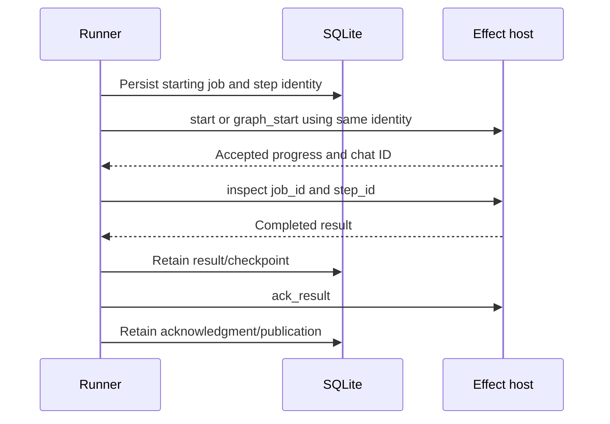

# Effect hosts and captured execution policy

Runner owns scheduling while a configured compatible host owns chat effects and Carrier-facing delivery. `serve --effect-host SOCKET` selects that host; `--suite-socket` remains an alias. Portable submissions cannot select arbitrary adapter code or override the host socket.



## Adapter operations

| Native plan | Graph binding | Responsibility |
| --- | --- | --- |
| `validate` | `graph_validate` | Host-side context/readiness admission; graph request includes whether chats exist |
| `start` | `graph_start`, controlled `graph_start_v2` | Accept chat work under stable job/step identity |
| `inspect` | `inspect` | Observe the existing external task |
| `ack_result` | `ack_result` | Acknowledge terminal task result |
| `cancel` | `cancel` | Ask owner to interrupt the named effect |
| `publish` | `graph_publish` | Deliver final success/failure report with retained job identity |

RPC sends `{op,args}` as one newline JSON frame. Response is `{ok:true,data:...}` or a structured error. Exchange timeout is 25 seconds; response framing is bounded to 4 MiB. Empty/truncated responses and connection/write/read failures use `suite_unavailable`; malformed complete envelopes use `suite_protocol`; oversized replies use `suite_response_limit`. Frame diagnostics include byte counts and operation name without response bodies/prompts. The retry classes are exactly `suite_unavailable`, `carrier_unavailable`, `io`; retries reuse identities. Permanent errors must remain visible.

The default socket resolves `SUITE_WORKFLOW_SOCKET`, otherwise `AGENTS_STATE_DIR/native-workflows.sock`, otherwise the XDG/HOME state `aixand/chats/native-workflows.sock` path. Explicit service configuration is preferable when hosts coexist.

## Policy ownership

| Contract | Runner checks and carries | Host owns |
| --- | --- | --- |
| Permission mode | `read-only`, `workspace-write`, `workspace-auto`, `full-access`; explicit stage coverage where required | Enforcement of sandbox/access |
| SDK approval | Compatible provider/backend pair and `ask` or `deny`; rejects claiming Codex presets for SDK execution | Actual approvals and tool execution |
| Profile selection | Controller, specific profile or validated auto pool | Provider quotas and account choice at stage launch |
| Resource capture | `stage` or `workflow`; strict workflow capture requires immutable resources for every chat | Resource resolution before submission and stage materialization |
| Agent context | Valid declared maps, forwarded context and Runner identity | Agent creation and authoritative session state |

Strict workflow resources use `agent-manager/resource-request-1` or `-2`, `inherit_profile:false`, instructions off or replace, explicit absolute stores, managed SHA-256 revisions or versioned release references, and explicit skills/MCP add arrays. Runner validates this shape; it does not import resource managers or resolve selections. Profile auto-selection timing is independent of resource identity capture.

Only `metadata.agent_context` is forwarded to execution, not arbitrary job metadata. Each labels/metadata map has at most 64 entries, 64-byte keys, values up to 256/4096 bytes respectively, no controls or reserved `agent_manager.*` keys. Context participates in submission identity. SDK setup adds orchestrator/job/run context and invocation step identity; native task IDs supply step identity at the host boundary.

[Effects and RPC](../../src/graph.rs), [native plan and provider validation](../../src/native.rs), [resource/profile validation](../../src/profiles.rs), [permission enum](../../src/permissions.rs), [agent-context envelope](../../src/model.rs), [transport failure tests](../../tests/workflow_transport.rs), [Server integration](../../../../apps/server/docs/integrations/native-workflows.md), [independent Orchestration MCP](../../../../mcps/orchestration/README.md).

## Agent context example

```json
{"metadata":{"agent_context":{"labels":{"app":"pathspec","workflow.run_id":"run-42"},"metadata":{"inputs.path":"/work/inputs.json"}}}}
```

This fragment belongs in a submission. Only the declared string maps are forwarded; the policy and bounds above apply.
