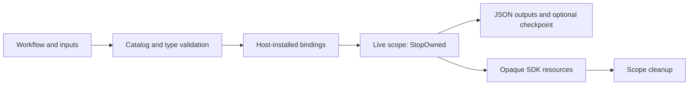

# IR execution and SDK resource boundaries

Runner imports the versioned IR crates directly. Catalogs describe portable operation contracts; executable bindings are registered by trusted host code. A submitted workflow cannot import code, install a binding or supply runtime credentials.



## Engine seam

| Method | Required meaning |
| --- | --- |
| `fingerprint` / `submission_fingerprint` | Pin executable environment and applicable contracts; native/graph v1/v2 have distinct fingerprints |
| `capabilities` | Advertise supported formats, amendments, continuations, adoption and policy families |
| `preflight` | Validate concrete submission before accepting new work |
| `preflight_template` | Validate continuation structure/bindings before mapped values exist |
| `execute` | Execute a nonjournaled workflow; native format rejects this with `checkpoint_required` |
| `execute_journaled` | Consume job identity, checkpoint writer, cancellation-intent reader and optional plan control |
| `resumable` | Explicit promise of durable recovery; default is false |

`IrEngine::verifier()` installs verifier bindings plus the graph catalogs. Embedders use `IrEngine::with_bindings(catalogs, bindings, binding_version)` and must change binding version when executable behavior changes incompatibly. Fingerprints include the Runner package version, binding version and applicable contracts; configured graph socket and SDK configuration also contribute. Effective-plan pin mismatch blocks a claimed job rather than silently running changed behavior.

## Optional embedded SDK

The default native distribution has no embedded Python SDK. Source builds can enable it explicitly:

```sh
cargo build --locked --features sdk
./target/debug/runner --home .runner serve --sdk-config /absolute/path/sdk.json
```

Without the feature, `--sdk-config` fails configuration. The host supplies Python paths and connections and installs sibling SDKs; see [existing SDK integration](../../../ir/README.md#existing-sdk-integration). Preflight imports/checks bindings without launching a live agent. Use the configured environment's `bin` on PATH so child workers see the same SDKs.

Each execution has a fresh `StopOwned` scope. SDK handles can flow between graph operations in that scope but cannot be serialized as portable workflow outputs or restored by journal events. Scope cleanup errors change job classification to uncertain. JSON-capable mutable graph publication can persist outputs; opaque outputs remain in scope until all newly admitted work finishes.

Successful SDK spawn/get observations retain `agent_session` data with invocation, provider, managed run and Undercurrent session identity. These identifiers support inspection; they contain no live opaque handle and do not establish task acceptance or delivery.

Host-installed versioned applications use `aixand.application.run@1.0.0`, selecting a configured application name and JSON arguments. The workflow cannot choose a Python import target. Application authors own cancellation/uncertain effects and incompatible version changes; see [application contract](../../../ir/README.md#host-installed-sdk-applications).

[Engine implementation](../../src/engine.rs), [IR binding registry](../../../ir/crates/aixand-ir-runner/src/registry.rs), [scope ownership](../../../ir/crates/aixand-ir-runner/src/scope.rs), [opaque graph tests](../../tests/graph.rs), [scope-preserving amendment test](../../tests/amendments.rs).

## SDK configuration example

```json
{
  "python_paths": ["/absolute/path/to/venv/lib/python3.14/site-packages"],
  "connection": {"state_dir": "/absolute/path/to/aixand-state"}
}
```

Use paths matching the embedded interpreter; runtime configuration stays outside submissions.
