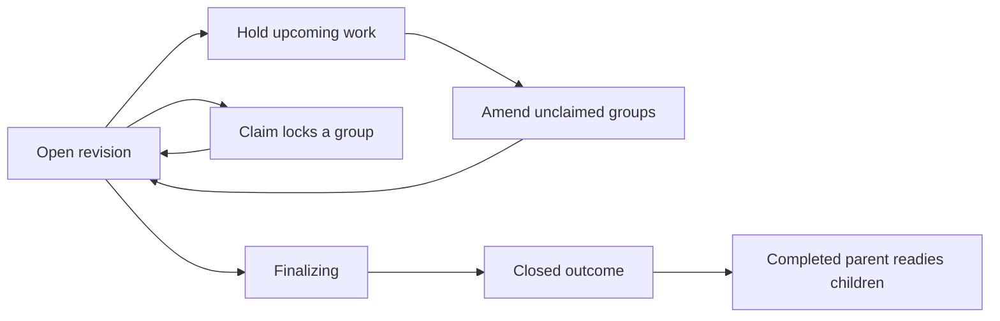

# Mutable plans, holds and continuations

A job's original submission and request digest remain immutable. Version-two native plans and workflow graphs gain a separate execution plan beginning at revision 1. Plan mutations share SQLite serialization with operation claims and finalization, so edits cannot retroactively rewrite started work.



## Plan and task contract

| Dimension | Values / rule |
| --- | --- |
| Phase | `legacy` for revision 0; mutable `open`, `finalizing`, `closed` |
| Hold | Blocks new unclaimed work and successful final sealing; already claimed work may proceed |
| Operation status | `claimed`, `completed`, `failed`, `uncertain`; snapshot maps invocation ID to retained state |
| Locked groups | Any group with an operation row is locked, including definitions, dependencies and chat policy |
| Amendment identity | Job plus key replays same request; changed content conflicts |
| Revision race | `expected_revision` must equal current revision, else `revision_conflict` |
| Removed IDs | Retired permanently; reintroduction requires a new identity |
| Finalization | Delivery claim or revision seal moves to finalizing; later edits fail `run_finalizing` |

An amendment validates workflow size, effective engine pin and preflight before the store rechecks races. Format/version, context, identity and declared run inputs stay fixed. Graph chat policies may change only where locked-group checks permit; authoring metadata is stored separately. Waiting/ready continuation mappings protect named parent exports from disappearing.

A `plan` snapshot includes revision, workflow, authoring, phase, held, engine digest, locked groups, operations and `status_sequence`. The last field is the maximum event sequence for that job, useful for correlating a snapshot with observations. `inspect` still returns the original submission; use `plan` for effective work.

## Legacy adoption

`enable_edits` supports native plans and flat graphs. It validates and pins a v2 candidate, persists a pending adoption, requests suspension and converts only after the job leaves running state. Started definitions and native requests are reconstructed from retained checkpoints/events; the adopted plan starts held at revision 1. Delivery already begun or settled work cannot be adopted. A started nonresumable SDK run fails `opaque_resources`; its scope must stay alive and follow-up work belongs in a continuation. A request can return `adoption_pending` after waiting; retry the same request rather than inventing another conversion.

## Continuation state contract

| State | Transition / meaning |
| --- | --- |
| `waiting` | Parent not yet completed, including uncertain parent |
| `ready` | Parent completed; dispatcher can map JSON inputs and preflight |
| `submitted` | Child job creation and parent/child link committed atomically |
| `skipped` | Parent failed, cancelled or blocked |
| `blocked` | Permanent mapping/preflight/pin error or conflicting/cancelled child key |
| `cancelled` | Registration cancelled before child submission |

A parent accepts at most 100 registrations. Parent plus registration key deduplicates the target template and `input_map`. The service replaces the target key with `runner:continuation:` plus a digest of parent ID and registration key. Mappings use JSON pointers into the full parent result; child inputs must be declared, supplied, mapped or defaulted. Template preflight happens at registration; concrete preflight and engine pin comparison happen after mapping. The dispatcher polls every 250 ms and leaves transient host errors ready for retry.

Child metadata carries `parent_job_id` and `root_job_id`. Agent context inherits application/project context while removing parent run/step/title and selected Suite stage fields; explicit child context overlays it. After a child exists, cancelling the registration fails `child_submitted` with its ID; cancel the child itself. Continuations create separate jobs, not replacement attempts in a settled parent.

[Plan store and GraphControl](../../src/plans.rs), [service mutation handlers and dispatcher](../../src/service.rs), [amendment/adoption/continuation tests](../../tests/amendments.rs), [IR control contract](../../../ir/crates/aixand-ir-runner/src/control.rs).

## CLI editing and continuation recipes

From `workflow/runner`, use the same home as the service. These arguments follow `runner --home HOME`:

```sh
runner --home HOME plan JOB-ID
runner --home HOME amend JOB-ID revised-workflow.json --key EDIT-KEY --revision N --authoring canvas.json
runner --home HOME hold JOB-ID
runner --home HOME release JOB-ID
runner --home HOME enable-edits JOB-ID --key ADOPT-KEY
runner --home HOME continue JOB-ID child-submission.json --key LINK-KEY --input-map mapping.json
runner --home HOME continuations JOB-ID
runner --home HOME cancel-continuation LINK-ID
runner --home HOME runs
```

`mapping.json` can contain `{"previous_result":"/result"}`. Empty pointer `""` selects the whole parent result; nonempty pointers begin with a declared export. Opaque handles cannot cross jobs. Use the exact original edit/key after a lost reply; fetch the new revision and use a new edit key after a revision conflict. Python wrappers cover plan mutations and continuations; history uses `Client.request("runs", ...)`, with no `runs()` convenience method. See [client operations](../../python/docs/reference/operations.md).
