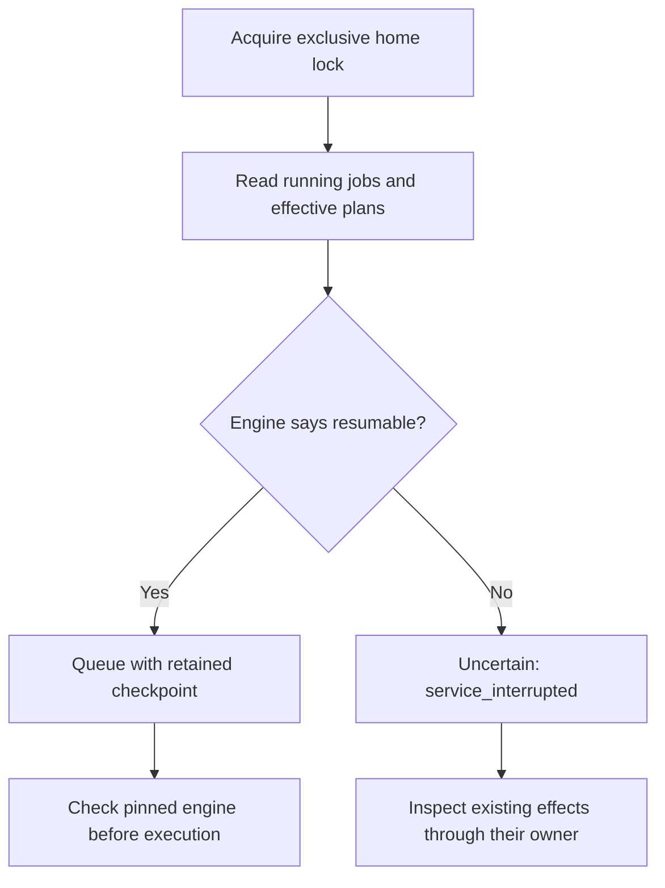

# Runner outcomes and recovery

Recovery preserves the distinction between a retained job outcome and an external effect whose completion is unconfirmed. Repeating the original submission never creates a replacement attempt just because the client lost a response. Native reconciliation can resume existing identities; opaque execution cannot be reconstructed from event history.

## Job outcome contract

| State | Meaning and follow-up |
| --- | --- |
| `queued` | Accepted, waiting for eligible claim or resumed reconciliation |
| `running` | Attempt claim and new `ATT-` identity retained; execution active |
| `completed` | Execution returned JSON and cleanup succeeded; caller still evaluates application result |
| `failed` | Execution error or result over 8 MiB; absence of external effects is not implied |
| `cancelled` | Unstarted queued job removed, or cooperative cancellation returned with successful cleanup |
| `blocked` | Effective plan's pinned engine differs at claim; inspect configuration before new reviewed work |
| `uncertain` | Interruption of nonresumable work, panic, unconfirmed cleanup/effect, failed journaling or shutdown timeout |

The model considers every state except queued/running settled. Uncertain is therefore settled for polling, although eligible native work can later be explicitly resumed. Job state, plan phase and per-task status are separate dimensions.

## Resumability is an engine decision

| Work | Current recovery behavior |
| --- | --- |
| Native chat format | `WorkflowEngine` declares resumable; checkpoint retains stage identities, results, acknowledgment and delivery |
| Graph containing only `workflow.value`, `workflow.text`, `verifier.verify`, `aixand.project.chat`, `carrier.human.deliver` | Resumable; restore published JSON and reconcile host effects using stable job/step IDs |
| Graph with other operations, including opaque SDK resources | Not resumable, even if some values happen to be JSON |
| Standalone portable IR through `IrEngine` | Not resumable; no generic automatic retry or step restoration |
| Custom embedded engine | Must explicitly implement resumability and journal semantics; default trait behavior is false |

Startup converts running resumable work to queued and running nonresumable work to uncertain. It retains old attempt identity as evidence; the next claim creates a new attempt ID while keeping the job/effect identities. Queued work and settled results survive startup. `resume` first checks the effective submission's resumability and then accepts only an uncertain job, emitting `reconcile_requested`.

## Cancellation and shutdown

`cancel` durably sets intent before signaling the selected live token. An unstarted queued job becomes cancelled immediately. A resumable queued job with a previous attempt stays queued so cleanup can execute; cancelling an uncertain resumable job likewise queues it. `cancel_key` additionally records a permanent tombstone that prevents late acceptance under that key.

Cancellation does not roll back effects. A successful execution can win the race and remain completed. For native caller cancellation, Runner calls host `cancel` for checkpointed steps. Unconfirmed cleanup yields uncertainty. Service shutdown of resumable work suspends scheduling without pretending the caller requested cancellation; native external chats remain identified for reconciliation. Nonresumable shutdown requests cancellation and cleanup. The service waits ten seconds, then records `shutdown_timeout` if possible.

Errors after an observed workflow completion, cleanup errors, `binding_panic`, `runner_panic`, `runner_task` and `effect_uncertain` take precedence over ordinary failure/cancellation and yield uncertainty. A journal failure also takes precedence.

## Inspection path

Retain key, job ID, attempt ID, event cursor and host chat/session IDs. Use `lookup`, `inspect`, `plan`, `events` and `result` before mutation. Correct host/storage availability and reconcile eligible native work using existing identities. For nonresumable work, inspect effects in their owning systems before submitting reviewed follow-up under a new key. There is no generic compensation or exactly-once guarantee for arbitrary bindings.

[Recovery and cancellation implementation](../../src/store.rs), [outcome classification](../../src/service.rs), [resumability allowlist](../../src/graph.rs), [native engine](../../src/native.rs), [crash test](../../tests/process.rs), [cleanup and cancellation tests](../../tests/jobs.rs), [lost-reply tests](../../tests/workflow_transport.rs).
