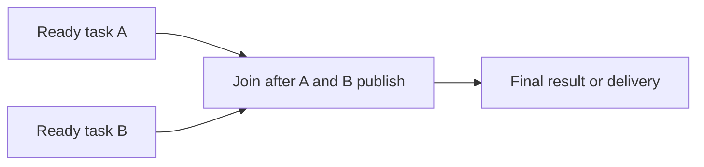

# Workflow DAG and task scheduling

Runner has two scheduling layers: a bounded pool claims whole jobs, then the selected engine admits ready operations inside each job. Native chat workflows use a checkpoint loop; workflow graphs use the IR graph executor. Neither layer assumes that submission order serializes external effects across jobs.

## Formats and validation

| Format | Admission and scheduling |
| --- | --- |
| Portable IR | Parsed and type checked against catalogs and installed bindings; existing IR body semantics apply |
| `aixand.chat-workflow` v1/v2 | Named workflow, saved project/source-chat UUIDs, 1–16 steps, distinct valid step IDs; validates dependencies, cycles, delivery step and access policy |
| `aixand.workflow-graph` v1/v2 | Flat IR operations and dependency map with 1–500 entries; dependencies cover every operation and reference distinct earlier operations; value references require dependency ancestry |
| Graph v2 groups | Nonempty groups cover every operation exactly once; at most one human delivery, which must depend transitively on all other operations |

Native dependencies need not appear earlier in the step array; the native validator traverses to detect cycles. IR graph dependencies must already appear earlier in the flat operation order. Do not interchange these authoring assumptions.

## Native stage loop

| Stage observation | Scheduler behavior |
| --- | --- |
| Missing checkpoint / pending | Eligible only when all dependencies are completed and acknowledged |
| `starting` | Persisted before `start`; transient failures retry the same job/step identity |
| `running`, `waiting`, `offline` | Poll `inspect`; emit changed progress observations |
| `completed` / `failed` | Retain result and retry `ack_result`; null results are marked acknowledged without RPC |
| `uncertain` | Stop with `effect_uncertain`; reconciliation is explicit |
| Workflow failure | Stop new admission, cancel active siblings, wait for cleanup/acknowledgments, publish failure report |
| All steps completed and acknowledged | Seal a mutable revision, publish delivery and retain final checkpoint |

All ready siblings receive `start` before waiting, so their external turns can overlap even though acceptance RPCs run sequentially. Native v2 adds declared typed JSON workflow inputs and selected `input_names` per step. A successful v2 native result also exports the delivery step result as checkpoint `result`.

## Graph executor

The IR executor starts operations whose dependencies have published outputs, overlaps independent futures and resolves references from published values. A join never substitutes an unsuccessful prerequisite's missing output. Restored outputs are checked against current operation contracts. Version-two execution consults `GraphControl` for current revision, hold status, atomic claim and final seal. Started operations retain their accepted definitions and scope while later unclaimed operations can change.

One live scope spans the graph, including opaque SDK handles used by spawn/send/wait operations. Cleanup occurs after the graph, not after each operation. Only approved resumable operation sets restore JSON publication; see [recovery](recovery.md).

[Native loop and validation](../../src/native.rs), [graph envelope and effects](../../src/graph.rs), [engine routing](../../src/engine.rs), [IR graph algorithm](../../../ir/crates/aixand-ir-runner/src/runner.rs), [graph tests](../../tests/graph.rs). The tests explicitly exercise sibling overlap, dependency joins, missing paths and opaque handles sharing a scope.
