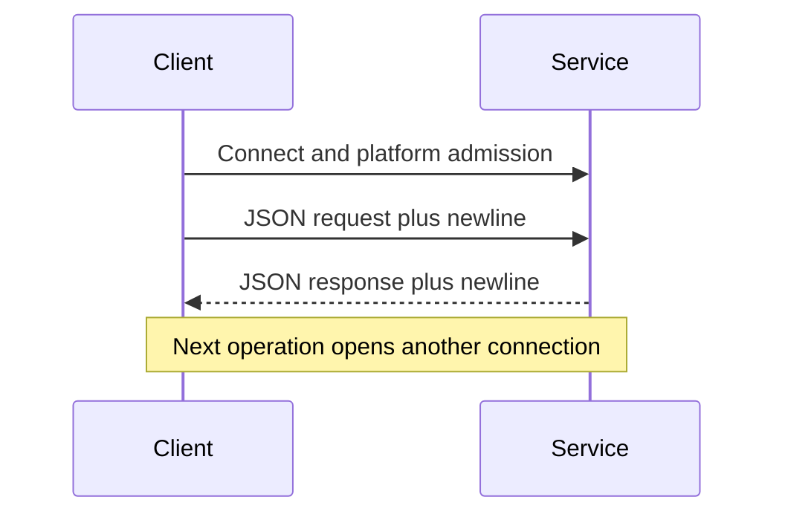

# Local protocol reference

Protocol 1 exposes job facts and explicit mutations over one local stream exchange per request. It is shared by the binary, Rust client and separately owned Python client. The exact authoritative request enum is [model.rs](../../src/model.rs); CLI argument mapping is [main.rs](../../src/main.rs).

## Operations

| `op` | Request fields besides op | Successful data |
| --- | --- | --- |
| `health` | None | Service/version/protocol, engine digest, workers, capabilities |
| `submit` | `submission` with key/workflow and optional inputs/metadata | `{job,replayed}` |
| `list` | Optional `after`, `limit` | `{jobs}` summaries in sequence order |
| `inspect` | `id` | Full original Job |
| `lookup` | `key` | Job or null |
| `result` | `id` | `{id,state,result,error}` |
| `events` | `id`, optional `after`, `limit` | `{events,state,next_after,has_more}` |
| `cancel` | `id` | Job after recording cancellation intent |
| `cancel_key` | `key` | Existing job or null plus durable tombstone |
| `resume` | `id` | Requeued uncertain resumable Job |
| `plan` | `id` | Effective PlanSnapshot |
| `amend` | `id,key,expected_revision,workflow`, optional `authoring` | `{revision,replayed,plan}` |
| `hold`, `release` | `id` | PlanSnapshot |
| `continue` | `id,key,target`, optional `input_map` | Continuation record |
| `continuations` | `id` of parent | `{continuations}` |
| `cancel_continuation` | `id` of registration | Continuation, or `child_submitted` |
| `runs` | Optional `offset`, `limit` | `{runs,has_more,next_offset}`; selected Suite-origin jobs in newest-first order |
| `enable_edits` | `id,key`, optional `authoring,groups,identities` | Adopted PlanSnapshot or pending/conflict error |

Success envelope is `{"ok":true,"data":...}`. Error envelope is `{"ok":false,"error":{"code":"...","message":"..."}}`, with optional details. Requests deny unknown fields. Timestamp fields are Unix milliseconds. `events --follow` is CLI polling every 250 ms after draining pages; it exits once page state is settled.

`runs` filters jobs whose metadata origin is `suite.chat` or `aixand.workflow-builder`, or whose declared agent-context app is `aixand-suite`. It is not an alternative list of every Runner job. Its offset is bounded to 1,000,000; rows include effective plan, title, project/origin chat, parent/workflow/namespace associations, error message and detected delivery receipt. See [projection implementation](../../src/plans.rs).

## Bounds and cursors

| Boundary | Value |
| --- | --- |
| Request frame | 4 MiB, including framing as checked by the stream/client |
| Response body | 16 MiB; oversized serialized responses become `response_limit` |
| Job result / checkpoint | 8 MiB each |
| Row page | Default 100, range 1–500; negative `after` rejected |
| Event cursor | Global event sequence filtered to one job; use returned `next_after` |
| Job list cursor | Submission sequence, independent of event sequence |
| Rust client | Whole request timeout 30 seconds; timeout may follow commit |
| Service stream | Five-second request read and response write deadlines |

## Error families

| Code/family | Interpretation |
| --- | --- |
| `request`, `request_limit`, `protocol`, `validation` | Framing, envelope or workflow admission failed |
| `conflict` | Reused submission/amendment/continuation key with different content |
| `cancelled` | Key tombstone or execution cancellation, depending on operation |
| `not_found`, `state`, `legacy_plan` | Unknown job or operation invalid for retained lifecycle |
| `engine_changed` | Effective execution environment no longer matches pin |
| `revision_conflict`, `step_locked`, `identity_retired`, `run_finalizing` | Plan mutation rejected by concurrent/admitted work |
| `effect_uncertain`, `journal_failed`, `shutdown_timeout` | Execution evidence or cleanup is incomplete; inspect before retry |
| `service_owned`, `storage`, `storage_version`, `socket` | Home ownership/storage/endpoint failure |

Host transport codes are described separately in [effect hosts](../integrations/effect-hosts.md). The list is a reading aid, not a closed enumeration: binding failures preserve their own codes and structured failure details. [Error conversions](../../src/error.rs), [socket tests](../../tests/jobs.rs), [CLI process tests](../../tests/process.rs).
