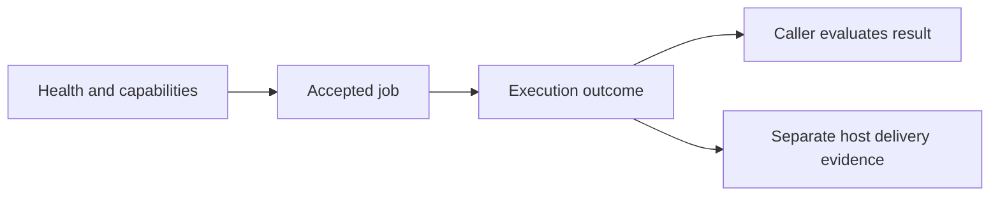

# Implementation status and limits

The source implements durable local jobs, two native chat versions, two graph versions, mutable plan admission and registered follow-up jobs. Scope and evidence must stay distinct: a capability advertised by `health` names a supported contract, not proof that any configured provider or host is currently available.

## Coverage and gaps

| Area | Implemented | Limit / evidence still needed |
| --- | --- | --- |
| Job durability | SQLite transitions/events, key replay, queued persistence, exclusive home | No retention cleanup or cross-home deduplication |
| Worker pool | 1–64 whole-job workers, FIFO eligible claims | No effect isolation or FIFO completion guarantee |
| Native chat recovery | Stable job/step identities, stage checkpoints, ack/delivery retry | Host must retain compatible idempotent effects; no rollback of remote work |
| Graph recovery | Allowlisted graph operations and JSON publication restoration | No arbitrary binding or opaque resource restoration |
| Plan edits | Revisions, group locks, holds, retirement, sealed requests, legacy adoption | Started nonresumable legacy SDK scope cannot be adopted |
| Continuations | Up to 100 per parent, pinned templates, mapped inputs, atomic child link | Wait for successful parent; no generic retry of a failed parent |
| SDK | Explicit feature, host config, scoped cleanup and session observations | Independent shipped binary omits SDK; live providers require separate qualification |
| Transport | Unix socket and protected Windows loopback descriptor | Platform-specific security/packaging needs target-native evidence |
| Installation | Stateful receipts, shared/private payloads, offline installed verification | No service auto-start, hosting deployment, signing or automatic updates established here |
| Tests | Unit, fake-host, socket, real crash and lifecycle test sources | Canvas-generated contract test ignored by default; fixture and activation tests do not prove live provider or future migration behavior |

## Documentation caveats

The retained [README outcome summary](../../README.md#outcomes-and-restart-behavior) broadly describes interrupted attempts becoming uncertain. Current [recovery implementation](../../src/store.rs) first asks the engine about the effective plan: native resumable work returns to queued. Use the [recovery matrix](../lifecycles/recovery.md#resumability-is-an-engine-decision) when changing that path. The README remains in place to preserve inbound links and commands.

`Engine::fingerprint` alone is not every submission's pin: graph/native versions and selected host configuration have specialized fingerprints. Likewise `Job.submission` is original content, while `plan` returns amended effective content. A settled uncertain job can still be reconciled if its effective workflow is resumable.

No screenshots are appropriate to the headless daemon. This architecture documentation does not claim that Rust tests, native installers or live provider calls ran during authoring. Consult the staged review report for checks actually performed and request supervisor review before applying the staged files.

[Service behavior](../../src/service.rs), [Engine specialization](../../src/engine.rs), [native routing](../../src/native.rs), [focused verification map](../development/verification.md).
