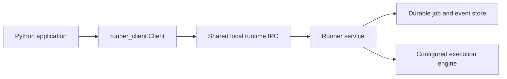

# Runner Client architecture

Runner Client is a synchronous, single-file Python adapter for Runner's local IPC protocol. It serializes requests, opens one connection per call, unwraps responses and offers a polling event iterator. Runner owns admission, execution, durable jobs, events and recovery. The client neither installs nor starts the daemon.

## Reading paths

| Change or investigation | Read |
| --- | --- |
| Understand ownership and endpoint selection | [Boundary](architecture/boundary.md), [transport](integrations/transport.md) |
| Integrate operations and JSON values | [Wire and types](reference/contracts.md), [operation map](reference/operations.md) |
| Diagnose a lost submission response | [Admission and recovery](lifecycles/recovery.md) |
| Follow events and interpret completion | [Observation](lifecycles/observation.md) |
| Edit a run or chain work | [Plans and continuations](lifecycles/plans.md) |
| Change or verify the client | [Development](development/verification.md) |

## Evidence boundaries

| Observation | Establishes |
| --- | --- |
| `health()` succeeds | Local service responded; returned capabilities describe its configured engine |
| `submit()` returns a job | Admission or replay of that existing job |
| `follow()` returns | Last drained page reported a state other than queued/running |
| `result()` reports completed | Execution completed; application outputs still need acceptance checks |

[Implementation](../runner_client.py) · [package metadata](../pyproject.toml) · [existing client guide](../README.md) · [Runner outcome reference](../../README.md#outcomes-and-restart-behavior).
