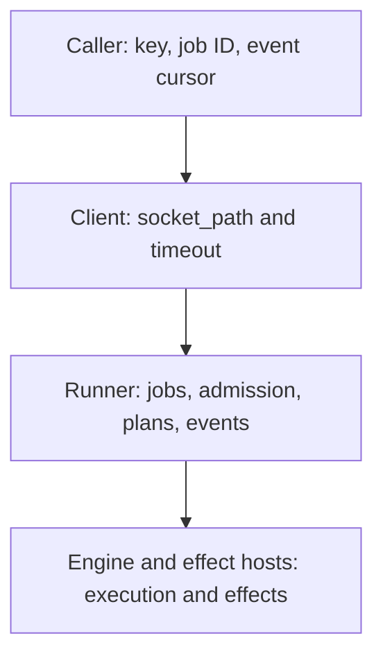

# Component boundary and ownership

The public module exports `Client` and `RunnerError`. There are no internal source subpackages, background workers, client database, asynchronous facade, workflow interpreter or agent dependency. The package is a single `py-modules = ["runner_client"]` distribution with one declared runtime dependency, `aixand-lib-local-runtime`.

## Ownership contracts

| Owner | State or responsibility | Consequence |
| --- | --- | --- |
| Caller | Submission key, exact submission content, returned job ID, consumed event cursor | Persist these when recovery crosses process restarts |
| Client instance | String `socket_path`, `timeout` | Constructor resolves configuration once; no connection is created there |
| Shared local runtime | OS stream connection and Windows endpoint authentication | Transport errors are not translated into `RunnerError` |
| Runner service/store | Canonical digest, deduplication, attempts, state, event journal, plan revisions | Retrying a submission never replaces the accepted record |
| Execution engine/effect host | Workflow validation, supported reconciliation, resource and agent operations | Client method availability does not prove engine capability |

`Client.request()` accepts a generic operation name and fields; wrappers add convenience, not a separate protocol. It does not cache health, negotiate a protocol version, validate a workflow, or retain a response history. Every call returns decoded JSON values. `list()` and `continuations()` select an array from their response envelope; `follow()` is the only generator.

## Integrations and scope

The client speaks only to Runner. Native chat workflows, portable IR and optional SDK execution are selected by Runner's engine, not imported or implemented in this module. Arbitrary job metadata remains job metadata; only declared `metadata.agent_context` is forwarded to agent context by Runner. It is included in admission identity and is not an authorization mechanism.

Read [Runner integration and execution reference](../../../README.md#effect-hosts-and-resource-capture) and [agent context](../../../README.md#agent-context) before changing host behavior. Changing the client package cannot establish provider readiness or live effect correctness.

Source: [client](../../runner_client.py), [packaging](../../pyproject.toml), [service dispatch](../../../src/service.rs), [engine](../../../src/engine.rs), [native execution](../../../src/native.rs).
