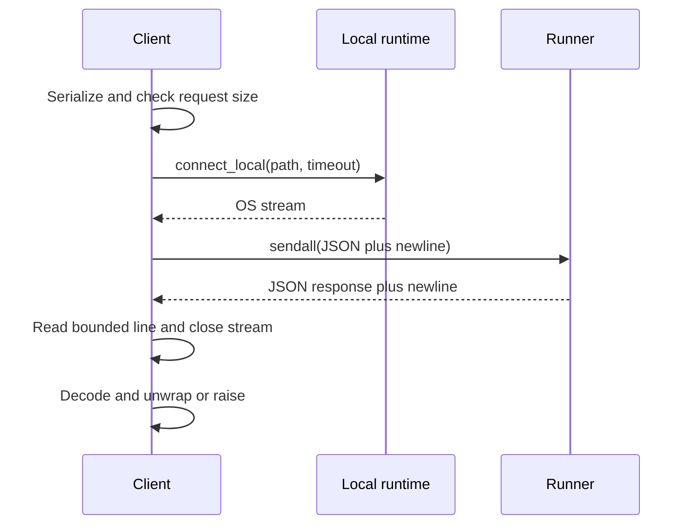

# Endpoint and OS transport

The constructor computes `home/runner.sock` and stores it as `socket_path`. It calls `connect_local(socket_path, timeout=timeout)` inside each request. The endpoint name is shared across OSes; its physical transport differs.

## Home resolution

First matching rule wins. An empty environment value counts as present; the implementation checks against `None`, not truthiness. Relative paths remain relative to the process working directory when used.

| Priority | Condition | Home |
| --- | --- | --- |
| 1 | Explicit `home` is not `None` | `Path(home)` |
| 2 | `RUNNER_HOME` exists | Its value |
| 3 | Windows and `XDG_STATE_HOME` absent | `LOCALAPPDATA/Aixand/Runner`, falling back to `Path.home()/AppData/Local/Aixand/Runner` |
| 4 | Otherwise | `XDG_STATE_HOME/runner`, falling back to `Path.home()/.local/state/runner` |

An existing instance does not re-resolve environment changes. Use the service's actual home and an OS identity permitted to access it. Creating a client does not create the home, probe readiness or launch a service.

## Platform boundary

| Platform | Transport | Authority boundary |
| --- | --- | --- |
| Unix | AF_UNIX stream at `runner.sock` | Local filesystem/socket access |
| Windows | Protected `runner.sock` descriptor for authenticated IPv4 loopback | Descriptor uses `aixand.local/1`, port and 64-character token; local-runtime authenticates before application JSON |

Windows is not a named-pipe or public HTTP transport. The shared runtime reads the descriptor anew on each connection. Runner's [transport implementation](../../../src/transport.rs) defines its peer behavior. Python delegates this behavior to its declared dependency; the dependency's installed implementation and Windows ACL enforcement need separate platform verification.

## Time and resource lifetime

`timeout` defaults to 30 and is passed unchanged to the transport. It is a socket timeout, not a whole-job deadline or guaranteed total request duration. Connection, write and read failures propagate. `with` blocks close the reader and connection after the read, including exceptional exits. There is no pool, persistent socket, reconnect loop or automatic request retry. A later call opens a new connection; a polling loop stops if that call raises.

Runner separately bounds reading a request and writing a response to five seconds each. These service limits do not cancel admitted work when a caller disappears. See [recovery](../lifecycles/recovery.md).

Source: [constructor and request](../../runner_client.py), [dependency range](../../pyproject.toml), [service framing](../../../src/service.rs).
