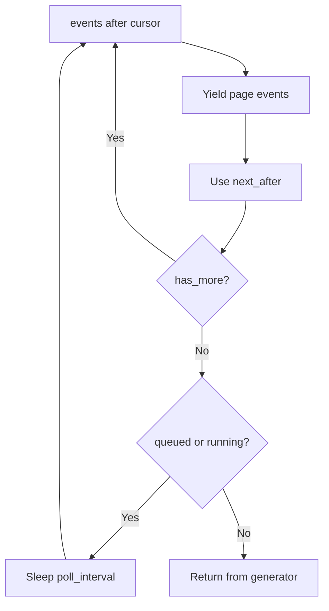

# Retained events and outcome observation

`events()` reads a durable page. `follow()` repeatedly reads those pages and yields each event; it is polling, not a subscription or persistent stream. Cursors refer to retained events, not an in-memory delivery channel.

## Pagination and delivery contract

| Behavior | Consequence for consumers |
| --- | --- |
| `after=0`, default limit 100 | Start at earliest retained events; use `events()` for custom page size |
| Server orders event sequence strictly after cursor | Retain last processed sequence to resume observation |
| `has_more` may reflect byte or row bound | Drain pages; do not infer exhaustion from page length |
| Cursor advances after all yielded page events resume | Consumer interruption can leave partial processing; persist progress per event if needed |
| Poll errors propagate | Caller decides when and where to resume; no internal reconnect |
| No overall follow deadline | A continuously queued/running job can be followed indefinitely |
| `poll_interval` is passed to `time.sleep` without validation | Invalid intervals can fail after a page; it is not an execution timeout |

The iterator does not return a result object, deduplicate consumer side effects, persist its cursor or send cancellation on close. Each page uses a new local connection. An observed state can change after a page; read fresh state after an explicit resume.

## Job states

| State | Meaning | `follow()` at exhausted page |
| --- | --- | --- |
| `queued` | Accepted, awaiting execution | Poll again |
| `running` | Attempt active | Poll again |
| `completed` | Outputs returned and cleanup succeeded | Stop |
| `failed` | Execution error; effects may exist | Stop |
| `cancelled` | Queue removal or confirmed execution cancellation/cleanup | Stop |
| `blocked` | Pinned engine configuration/contracts no longer match | Stop |
| `uncertain` | Interrupted attempt or unconfirmed execution/cleanup facts | Stop |

These are settled states for observation, not all successful outcomes. `completed` can contain application output `passed: false`. Read `result()` and validate exported outputs against the application's acceptance contract. Event kinds/data are passed through unchanged; agent-session observations can help resolve effect-owner identities but are not proof of application success.

Source: [follow and events](../../runner_client.py), [event page bounds](../../../src/store.rs), [state and event models](../../../src/model.rs), [runnable observation example](../../../examples/submit.py). See [recovery](recovery.md) and [outcomes](../../../README.md#outcomes-and-restart-behavior).
