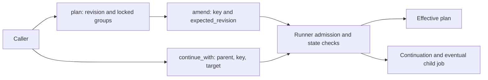

# Plan edits and continuation ownership

Python forwards plan and continuation operations without keeping an editable local model. Runner serializes plan revisions, operation claims and finalization in SQLite. The original submission stays immutable; read `plan()` for the effective workflow rather than assuming `inspect().submission.workflow` reflects later edits.

## Control contracts

| Operation | Responsibility and constraint |
| --- | --- |
| `plan` | Returns id, revision, workflow, authoring, held, phase, engine_digest, locked_groups, operations and status_sequence |
| `amend` | Required expected revision and operation key; service checks replay identity, pinned engine and workflow validity; claimed work constrains allowed changes |
| `hold` / `release` | Hold pauses admission of new work and keeps a finished body open for edits; already running operations continue; release wakes scheduling |
| `enable_edits` | Explicit legacy plan adoption using authoring/groups/identities; service may return an already adopted plan |
| `continue_with` | Registers a child target and input mapping durably; registration is not child completion |
| `continuations` | Returns records with id, parent_id, key, state, nullable child_id and error |
| `cancel_continuation` | Cancels an unsubmitted registration using its continuation ID; submitted children need their own job cancellation |

Initial supported version-2 graph/chat workflows receive revision 1. Legacy snapshots use revision 0 and phase `legacy`; adoption must satisfy engine compatibility and already-started scope constraints. No Python helper merges revisions or resolves an amendment conflict automatically.

## Continuation identity and inputs

`continue_with(job_id, target, key=..., input_map=...)` maps to wire `continue`. Runner validates the target submission, creates its deterministic child admission key from parent and registration key, carries reviewed context, adds parent/root job linkage, and checks declared child inputs. `input_map` maps child input names to JSON pointers into parent outputs, such as `{"previous_result":"/result"}`. Empty pointer `""` selects the whole result; nonempty pointers must begin with a declared export. Unmapped inputs must be supplied by target inputs or defaults. The service dispatches eligible registrations; inspect the returned continuation and eventual `child_id` separately.

The continuation record is a different identity from its parent and child jobs. Preserve the registration key when recovering a lost response. Existing Python wrappers do not verify state transitions, wait for a child or enforce an application output contract.

For exact supported edits, finalization rules and continuation behavior, retain the [Runner editing reference](../../../README.md#editing-and-chaining-runs). Implementation: [client wrappers](../../runner_client.py), [plan storage and receipts](../../../src/plans.rs), [service dispatch](../../../src/service.rs). Tests: [amendments and chaining](../../../tests/amendments.rs), [native workflows](../../../tests/workflow_transport.rs).
