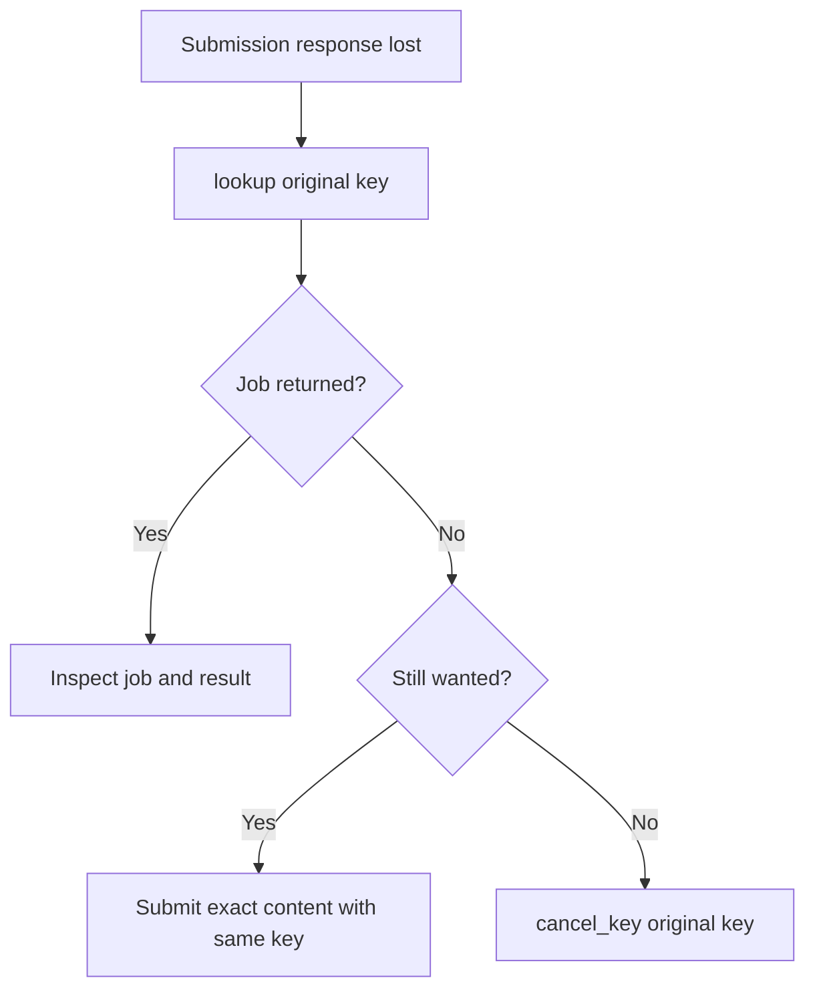

# Admission, cancellation and recovery

Keep the original submission content and key before the first send. A timeout or broken response can occur after Runner commits admission. Reuse that identity to inspect or recover the existing job; creating a new key can create new work.

A null lookup does not prove that an in-flight submission cannot commit later. Runner serializes `cancel_key()` with admission and retains a cancellation tombstone even when no job exists yet. The client does not implement this race protection itself.

## Identity and state

| Identity | Meaning | Recovery rule |
| --- | --- | --- |
| Submission key | Caller identity scoped to the Runner store | Same canonical content returns existing job with `replayed=true`; changed content conflicts |
| Job ID | Durable accepted job | Read via inspect/result/events; retrying submit does not rerun it |
| Attempt ID | Runner execution attempt identity | Retain for diagnostics; not generated by Python |
| Amendment/continuation key | Identity for its control operation | Preserve exact operation content; do not substitute a new operation to hide ambiguity |

Runner checks existing submission identity before engine preflight, allowing lost receipts to be recovered even after configuration changes. Initial preflight can still fail before admission. A cancelled unseen key rejects future fresh admission under that key; genuinely new reviewed work requires a new key.

## Error handling

| Failure surface | What Python raises/returns | What it proves |
| --- | --- | --- |
| Request serialization or local size bound | `TypeError`/`ValueError` | This call did not connect |
| Missing endpoint, access denied, connection/read/write timeout | Transport exception propagated, commonly `OSError`/`TimeoutError` | Outcome may be unknown if request was sent |
| Truncated/oversized line | `ValueError` | No usable receipt; admission may have happened |
| Invalid JSON or malformed envelope | JSON decoder/shape exceptions such as `KeyError` | Peer contract failure; no normalization layer |
| Service `ok=false` | `RunnerError` with code/details | Service rejected or could not process that operation |
| Service `ok=true`, job failed/uncertain | Returned JSON data | Request succeeded; inspect job outcome separately |

Service codes include `request`, `validation`, `conflict`, `not_found`, `cancelled`, `state`, `engine_changed`, `response_limit`, `storage` and `io`; this is not an exhaustive enum. Preserve message and details rather than classifying all failures as retryable.

## Cancellation and restart

`cancel()` records cooperative cancellation and signals active work. It does not undo effects; completion can win the race. `cancel_key()` also fences a pending submission. Closing a request or abandoning `follow()` sends neither operation.

After service restart, Runner requeues previously running work only when its engine declares the effective workflow resumable; other interrupted attempts become uncertain. Existing queued jobs and settled results remain retained. The Python client has no reconnect/retry policy or local recovery journal. A subsequent method call creates a fresh connection. `resume()` explicitly reconciles an uncertain job when its engine supports the workflow, including native chat plans and allowlisted JSON graph operations, using retained effect identities. Opaque SDK and standalone IR work have no generic replay. See [Runner recovery](../../../docs/lifecycles/recovery.md#resumability-is-an-engine-decision).

Source: [client](../../runner_client.py), [admission/cancellation transactions](../../../src/store.rs), [service preflight and resume](../../../src/service.rs). Evidence: [deduplication, cancellation and state tests](../../../tests/jobs.rs), [crash/restart test](../../../tests/process.rs). See [Runner outcome contract](../../../README.md#outcomes-and-restart-behavior).
